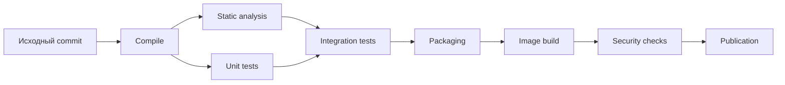

---
---

# Построение CI pipeline

## Содержание

1. [Актуальность материала](#актуальность-материала)
2. [Переносимая модель](#переносимая-модель)
3. [Стадии и gates](#стадии-и-gates)
4. [Пример для Java на GitHub Actions](#пример-для-java-на-github-actions)
5. [Производительность и безопасность](#производительность-и-безопасность)
6. [Типичные ошибки](#типичные-ошибки)
7. [Практические упражнения](#практические-упражнения)
8. [Вопросы для самопроверки](#вопросы-для-самопроверки)
9. [Связанные темы](#связанные-темы)

## Актуальность материала

- **Дата проверки исправлений:** 2026-10-15: передача JAR, checksum, Docker runtime build и Scout exit-code; остальная редакция — 2026-08-04.
- **Целевые версии примера:** Java 21 LTS, Maven 3.9.x, Docker Engine 28.x/BuildKit, GitHub-hosted `ubuntu-24.04`; action refs и plugin versions закреплены в workflow/POM. Docker Scout устанавливается отдельно для публикации.
- **Статус примера:** `current` для учебного package/runtime integrity; публикация и CVE gate требуют отдельного запуска и не объявляются выполненными.
- **Первичные источники:** [GitHub: build and test Java with Maven](https://docs.github.com/en/actions/use-cases-and-examples/building-and-testing/building-and-testing-java-with-maven), [GitHub artifact attestations](https://docs.github.com/en/actions/security-for-github-actions/using-artifact-attestations), [Maven lifecycle](https://maven.apache.org/guides/introduction/introduction-to-the-lifecycle.html), [Docker build-push action](https://github.com/docker/build-push-action), [SLSA specification](https://slsa.dev/spec/), [GitHub artifacts](https://docs.github.com/en/actions/tutorials/store-and-share-data), [Scout CVE gate](https://docs.docker.com/reference/cli/docker/scout/cves/).

## Переносимая модель

Pipeline — ориентированный ациклический граф работ с явными входами, выходами и policy gates. Его контракт не зависит от YAML конкретной платформы:



Переносимые свойства:

- source input — точный commit SHA; зависимости разрешаются из доверенных repositories;
- каждая работа имеет ограниченные permissions, timeout и machine-readable report;
- артефакт собирается один раз, получает checksum/digest, SBOM и provenance;
- publication выполняется только из защищённой ветки/tag, а PR из fork не получает publish secrets;
- кэш ускоряет сборку, но не является release artifact и не должен смешивать недоверенные данные.

Синтаксис `jobs`, `needs`, `${{ }}` и названия actions ниже — специфика GitHub Actions. В GitLab CI, Jenkins, Tekton или AWS CodeBuild сохраните граф и контракты, заменив адаптеры.

## Стадии и gates

| Стадия | Что доказывает | Типичный выход |
|---|---|---|
| Compile | Код и generated sources компилируются | classes, compiler diagnostics |
| Static analysis | Соблюдены style, bug/security rules | SARIF/HTML/XML report |
| Unit tests | Локальная бизнес-логика корректна | JUnit XML, coverage |
| Integration tests | Контракты с БД/брокером работают | JUnit XML, container logs |
| Packaging | Создан deployable package | JAR/WAR + checksum |
| Image build | Package помещён в runtime image | OCI image digest |
| Security checks | Проверены зависимости, source/image, SBOM/policy | отчёт и policy verdict |
| Publication | Проверенный объект помещён в registry | immutable URI/digest + provenance |

`mvn verify` может технически выполнить несколько стадий одной командой. Логически разделяйте результаты и причины отказа; физически не дробите job, если это заставляет повторно компилировать проект и терять feedback speed.

Security checks включают secret scanning до merge, SAST и dependency analysis по source, scan файловой системы/образа и проверку лицензий/policy. Scanner finding не равен риску: задайте severity, exploitability, SLA исключения и владельца waiver.

## Пример для Java на GitHub Actions

В репозитории есть [законченный пример](../examples/infra/01-ci-package/README.html) и [ручной GitHub Actions workflow](../.github/workflows/infra-example.yml). Он проверяет конкретный контракт: **JAR из verify-job попадает в runtime image без повторной компиляции**. Workflow не публикует image и не выполняет deployment.

```text
verify job: Maven verify → app.jar + SHA-256 → upload-artifact
image job: download-artifact → checksum → runtime-only Dockerfile
           → извлечь JAR из image и сравнить SHA → positive/negative smoke
           → non-root/read-only runtime gate → image-evidence.json
```

Локальный эквивалент из корня репозитория:

```bash
bash examples/infra/01-ci-package/01-package.sh
bash examples/infra/01-ci-package/02-image-gate.sh infra-order-total:local
cat examples/infra/01-ci-package/target/release/image-evidence.json
```

В build context передаются только проверенный `app.jar` и checksum. Dockerfile содержит `FROM`, `COPY`, `USER`, `ENTRYPOINT`, но не Maven/Gradle и не source. Image gate разрешает base tag в digest, извлекает JAR обратно, сравнивает bytes и выполняет как успешный расчёт заказа, так и отказ для неверного количества. Изменённый package, неверный UID, ошибочный exit code или несовпадение checksum останавливают pipeline. Между jobs архив GitHub Artifact не заменяет явно проверяемый checksum приложения.

`image-evidence.json` сохраняет source commit, JAR SHA-256, base digest и `localImageId`. До push `registryDigest` равен `null`: локальный image/config ID нельзя выдавать за digest опубликованного manifest. Учебный workflow проверяет package/runtime integrity, но **не объявляет image прошедшим vulnerability policy** (`vulnerabilityGate: not-run`).

Для явной публикации предусмотрен отдельный `03-publish.sh`: он проверяет, что tag всё ещё указывает на проверенный image ID, выполняет конкретный `docker scout cves --exit-code --only-severity critical,high`, останавливается при находках или сбое scanner и лишь затем делает push и сохраняет registry digest. Предусловия — Docker Scout, его credentials, `docker login` и разрешённый repository. Этот шаг вручную запускают только в доверенном ref/context после обязательных gates. Ни публикация, ни её успех самим наличием workflow не подразумеваются.

Это небольшой исполнимый пример передачи артефакта; static analysis, integration tests, SBOM/signatures/provenance и approval policy из таблицы выше добавляют как отдельные обязательные стадии реального production pipeline. Для Maven integration tests связывайте Failsafe с `integration-test`/`verify`; fixtures — изолированные services или [Testcontainers](../тестирование/02-testcontainers.html).

## Производительность и безопасность

- Запускайте дешёвые проверки раньше и параллельно, отменяйте superseded runs.
- Ключ кэша должен учитывать ОС, JDK и lock/build files; cache miss не должен ломать сборку.
- Минимизируйте `GITHUB_TOKEN` permissions; cloud credentials выдавайте краткоживущими через OIDC.
- Не выполняйте недоверенный PR-код в контексте с secrets (`pull_request_target` особенно опасен).
- Фиксируйте third-party actions по SHA и обновляйте контролируемым ботом.
- Сохраняйте reports даже при отказе (`if: always()`), но publication — только при успехе gates.
- Воспроизводимость проверяйте clean build; не переносите workspace между доверительными границами.

## Типичные ошибки

- **Одна непрозрачная команда:** публиковать отдельные reports и понятные gate names.
- **Image пересобирают перед каждой средой:** продвигать один digest.
- **Тесты после publication:** сначала gate, затем release repository/quarantine promotion.
- **Плавающие `latest` и action tags:** использовать SHA/digest и автоматизированные обновления.
- **Все CVE блокируют навсегда:** formalize policy и срок исключения, не отключать scanner.

## Практические упражнения

1. Перенесите граф на другую CI-платформу, сохранив входы, выходы и gates.
2. Добавьте matrix для Java 21 и 25, но разрешите publication только из одного baseline.
3. Смоделируйте compromised third-party action и уменьшите blast radius permissions.

## Вопросы для самопроверки

1. **Что здесь переносимо?** Граф стадий, контракты, gates, идентичность артефакта и security boundaries.
2. **Почему package и image — разные выходы?** JAR является приложением, OCI image добавляет runtime filesystem/config и собственный digest.
3. **Можно ли считать cache артефактом?** Нет: это недоверенная оптимизация, не release evidence.
4. **Когда публиковать?** После обязательных проверок и только из доверенного ref/context.

## Связанные темы

- [Git workflow и code review](01-git-и-code-review.html)
- [Артефакты и promotion](03-артефакты-и-promotion.html)
- [Тестирование](../тестирование/README.html)

<script type="module" src="../assets/mermaid-init.js"></script>
