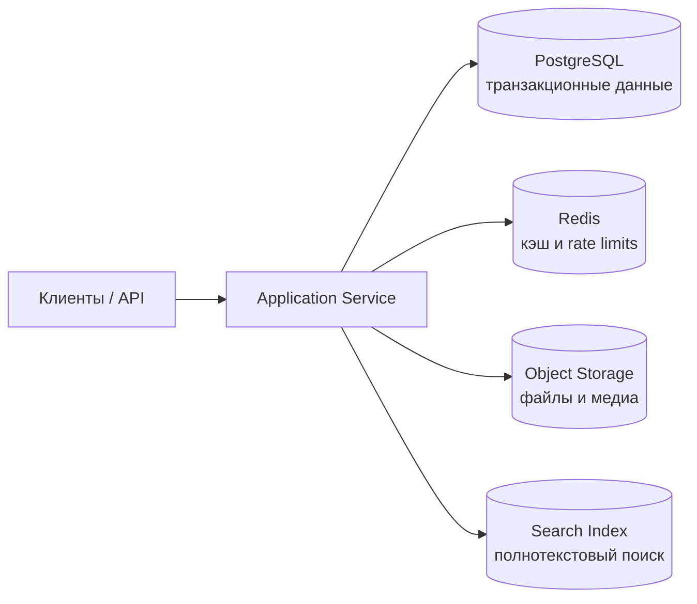

---
---

# Хранение данных и выбор базы

## Содержание

1. [Актуальность материала](#актуальность-материала)
2. [Как выбирать storage](#как-выбирать-storage)
   - [Пример polyglot persistence](#пример-polyglot-persistence)
3. [SQL vs NoSQL](#sql-vs-nosql)
4. [Индексы, репликация и шардирование](#индексы-репликация-и-шардирование)
5. [Consistent hashing, object storage и специализированные хранилища](#consistent-hashing-object-storage-и-специализированные-хранилища)
6. [Транзакции, изоляция и согласованность](#транзакции-изоляция-и-согласованность)
7. [CQRS и разделение read/write нагрузки](#cqrs-и-разделение-readwrite-нагрузки)
8. [Практические рекомендации по моделированию данных](#практические-рекомендации-по-моделированию-данных)
9. [Антипаттерны](#антипаттерны)
10. [Вопросы для самопроверки](#вопросы-для-самопроверки)
11. [🔗 Связанные темы](#-связанные-темы)

## Актуальность материала

- **Дата проверки:** 2026-10-15 — уточнены SQL/NoSQL, изоляция и варианты CQRS; остальные обзорные рекомендации ревизии 2026-08-04.
- **Целевая версия или диапазон:** концепции storage; для конкретного примера изоляции — PostgreSQL 18.
- **Статус примеров:** `current`
- **Первичные источники:** [PostgreSQL 18: уровни изоляции](https://www.postgresql.org/docs/18/transaction-iso.html), [репликация и failover](https://www.postgresql.org/docs/18/warm-standby.html), [Microsoft: CQRS с общей и отдельными БД](https://learn.microsoft.com/en-us/azure/architecture/patterns/cqrs).

## Как выбирать storage

База данных выбирается под паттерн доступа к данным, а не под абстрактную «современность». Полезно ответить на вопросы:

- данные больше читаются или записываются;
- важны ли join и сложные ad-hoc запросы;
- есть ли строгие транзакции между несколькими сущностями;
- каков объём данных и темп роста;
- нужно ли глобальное распределение по регионам;
- насколько допустима eventual consistency.

Часто в одной системе используется несколько видов storage: реляционная БД для транзакционных данных, Redis для кэша, object storage для файлов, search engine для полнотекстового поиска.

### Пример polyglot persistence

Такой дизайн полезен, когда у разных типов данных и запросов слишком разные требования к latency, консистентности и способу доступа.

## SQL vs NoSQL

SQL — язык и семейство моделей работы с данными; NoSQL объединяет разные document, key-value, wide-column и другие системы. Эти названия не определяют автоматически масштабируемость, транзакции и консистентность. Сравнивайте конкретные продукты, топологию и настройки по требованиям:

| Критерий | Что проверить в выбранном хранилище |
|----------|------------------------------------|
| Модель и схема | Типы, constraints, миграции, валидация документов и стоимость изменения модели |
| Транзакционная граница | Одна запись, partition или несколько сущностей; какие инварианты защищены атомарно |
| Конкуренция | Уровень изоляции, условные записи, retry конфликтов; не путать изоляцию с репликационной консистентностью |
| Запросы | Реальные фильтры, join, индексы, сортировки и пределы cross-partition запросов |
| Масштабирование | Где проходит shard key, что происходит с hot keys, rebalancing и межшардовыми операциями |
| Репликация | Что подтверждает ACK, откуда читаем, какой lag допустим, что теряем при failover |
| Эксплуатация | Restore, наблюдаемость, стоимость, опыт команды и лимиты managed-варианта |

Для CRUD с несколькими связанными сущностями PostgreSQL часто даёт удобный baseline. Простая модель доступа или высокая нагрузка могут оправдать другое хранилище, но сначала назовите конкретный bottleneck и измерьте альтернативу. Частое изменение JSON само по себе не доказывает необходимость NoSQL; наличие SQL не обещает линейризуемость чтений с любой реплики.

**Пример решения:** для каталога нужны уникальный SKU, атомарная история цены и фильтрация по категории. Начните с транзакционной БД и проверенного индекса. Отдельный search index добавляйте для требований к поиску с допуском lag, а не ради ярлыка «scale-out». Сравните с [практикумом каталога](../практикумы/01-синхронный-crud-сервис.html).

## Индексы, репликация и шардирование

**Индексы** ускоряют чтение, но замедляют запись и занимают память/диск. Их нужно строить под реальные запросы, а не «на всякий случай».

**Репликация** помогает:

- повысить availability;
- разгрузить primary на чтениях;
- приблизить данные к пользователям географически.

Но репликация приносит lag, а значит — риск чтения устаревших данных.

**Шардирование** делит данные по нескольким узлам и становится нужно, когда одна машина перестаёт справляться по диску, CPU или IOPS. Главная задача — выбрать shard key так, чтобы избежать горячих шардов и дисбаланса.

## Consistent hashing, object storage и специализированные хранилища

Не все данные живут в одной транзакционной БД. В system design важно понимать, когда нужны специализированные storage:

- **Object storage** — для файлов, медиа, бэкапов, архивов, больших immutable-объектов;
- **Search index** — для полнотекстового поиска и релевантности;
- **Time-series storage** — для метрик, событий телеметрии и агрегатов по времени;
- **Cache/key-value storage** — для очень быстрых чтений, ephemeral state и throttling.

При масштабировании key-value и cache-контуров часто используют **consistent hashing**. Идея в том, чтобы при добавлении или удалении узла перераспределять не все ключи, а только часть. Это уменьшает churn, упрощает rebalance и снижает вероятность массового cache miss после изменения topology.

Важно помнить, что object storage — это не «ещё одна БД». Он отлично подходит для больших бинарных объектов и дешёвого хранения, но не заменяет OLTP-базу с транзакциями и query semantics.

## Транзакции, изоляция и согласованность

Транзакция удобна внутри одной БД, но при межсервисном взаимодействии «глобальная транзакция» обычно слишком дорога или ненадёжна. Поэтому часто применяют:

- local transaction + event/outbox;
- saga orchestration/choreography;
- идемпотентную компенсацию вместо распределённого rollback.

Полезно различать:

- **read-your-writes** consistency;
- **monotonic reads**;
- **causal consistency**;
- строгую линейризуемость там, где она действительно нужна.

Также полезно понимать цену изоляции:

- более сильные уровни изоляции уменьшают аномалии чтения и записи;
- но блокировки и конфликтующие транзакции могут снижать throughput;
- hotspot-строки и «горячие аккаунты» часто упираются не в CPU, а в contention и lock waits.

Если в системе много конкурентных обновлений одних и тех же сущностей, заранее решайте, какой подход нужен: optimistic locking, pessimistic locking, очередь команд, serial execution per key или компенсационные механизмы.

## CQRS и разделение read/write нагрузки

**CQRS** имеет смысл, когда чтения и записи сильно различаются по модели или нагрузке. Примеры:

- write model хранит нормализованные данные и гарантирует инварианты;
- read model денормализована и оптимизирована под UI или отчёты.

CQRS разделяет модели команд и запросов, но не требует двух БД, событий или eventual consistency:

- **Общая БД:** command handler обновляет данные транзакционно, query handler строит DTO отдельным запросом. После commit чтение с primary может видеть запись без асинхронного projection lag; гарантии зависят от изоляции и выбранного источника чтения.
- **Разные read/write stores:** outbox/CDC обновляет проекцию асинхронно. Здесь нужен контракт допустимой устарелости, контроль lag, идемпотентность consumer и процедура пересборки.

Плата за логическое разделение — дополнительная модель и код. Асинхронная синхронизация, отладка расхождений и eventual consistency относятся ко второму варианту. В ADR фиксируйте, какую выгоду даёт каждый следующий шаг; event sourcing — отдельное решение.

Используйте CQRS там, где есть явная выгода, а не как архитектурную моду.

## Практические рекомендации по моделированию данных

- моделируйте данные под ключевые use cases, а не под «идеальную» абстракцию;
- выделяйте hot path и оптимизируйте его отдельно;
- избегайте больших транзакций и тяжёлых блокировок в пиковом контуре;
- заранее продумывайте retention, archive и cleanup policy;
- храните audit trail там, где это важно для бизнеса и расследований.

## Антипаттерны

- выбор NoSQL только из-за слов «масштабируемость» и «microservices»;
- универсальная БД на все случаи жизни;
- избыточная денормализация без контроля консистентности;
- шардирование до появления реальной потребности;
- отсутствие стратегии миграций и schema evolution.

## Вопросы для самопроверки

1. Когда PostgreSQL лучше document database, даже в high-load системе?
2. Что даёт read replica и какой риск она приносит?
3. Почему shard key — критичное решение?
4. Когда CQRS приносит выгоду, а когда только усложняет систему?
5. Зачем в distributed cache и shard-кластерах используют consistent hashing?
6. Когда object storage лучше обычной БД?
7. Чем опасна денормализация без явного владельца данных?

## 🔗 Связанные темы

- [PostgreSQL](../базы%20данных/postgresql/README.html) — углубление по MVCC, индексам, транзакциям и партиционированию
- [Партиционирование и шардинг в PostgreSQL](../базы%20данных/postgresql/09-partitioning-sharding.html) — практический взгляд на scale-out данных
