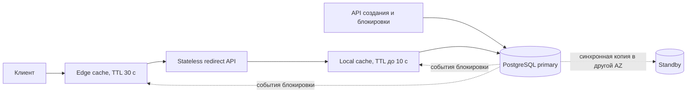

---
---

# Разбор популярных задач и подготовка к интервью

## Содержание

1. [Актуальность материала](#актуальность-материала)
2. [Как проходит system design interview](#как-проходит-system-design-interview)
3. [Универсальный шаблон ответа](#универсальный-шаблон-ответа)
4. [Кейс: URL shortener](#кейс-url-shortener)
   - [Требования и оценка нагрузки](#требования-и-оценка-нагрузки)
   - [Контракт, ключи и данные](#контракт-ключи-и-данные)
   - [Два варианта и выбор baseline](#два-варианта-и-выбор-baseline)
   - [Отказы и рост нагрузки](#отказы-и-рост-нагрузки)
5. [Кейс: чат или real-time messaging](#кейс-чат-или-real-time-messaging)
6. [Кейс: news feed](#кейс-news-feed)
7. [Кейс: rate limiter](#кейс-rate-limiter)
8. [Типовые вопросы интервьюера](#типовые-вопросы-интервьюера)
9. [Практические советы по подготовке](#практические-советы-по-подготовке)
10. [Вопросы для самопроверки](#вопросы-для-самопроверки)

## Актуальность материала

- **Дата проверки:** 2026-10-15 — числовой кейс URL shortener, HTTP-контракт и рубрика; остальные интервью-рекомендации ревизии 2026-08-04.
- **Целевая версия или диапазон:** HTTP по RFC 9110; SQL-модель для PostgreSQL 18; нагрузка и стоимость — учебные assumptions.
- **Статус примеров:** `current`; значения capacity не являются результатами benchmark.
- **Первичные источники:** [RFC 9110: редиректы и условные HTTP-запросы](https://www.rfc-editor.org/rfc/rfc9110.html), [PostgreSQL 18: unique constraints / ON CONFLICT](https://www.postgresql.org/docs/18/sql-insert.html), [Google SRE: SLI и SLO](https://sre.google/sre-book/service-level-objectives/).

## Как проходит system design interview

Обычно интервью проверяет не знание одной «правильной схемы», а умение:

- уточнять требования;
- оценивать масштаб и ограничения;
- выбирать архитектурные компоненты осознанно;
- видеть риски и bottleneck;
- обсуждать компромиссы и эволюцию решения.

Интервьюер почти всегда помогает вопросами. Это не допрос, а совместный design session.

## Универсальный шаблон ответа

1. **Уточните функциональные требования**.
2. **Зафиксируйте нефункциональные требования**: latency, availability, consistency, scale.
3. **Оцените нагрузку**: order of magnitude, а не точность до процента.
4. **Нарисуйте high-level architecture**.
5. **Погрузитесь в 2–3 критичных места**: storage, cache, queue, consistency, failures.
6. **Проговорите operational aspects**: observability, scaling, deployment.
7. **Опишите, как система эволюционирует при росте**.

## Кейс: URL shortener

### Требования и оценка нагрузки

**Функции:** создать случайный короткий код, разрешить его в исходный HTTP(S) URL, истечь или заблокировать ссылку. Custom aliases и точная аналитика каждого перехода в первую версию не входят. Созданные ссылки не редактируются; блокировка должна вступать в силу не позже 60 секунд. Защиту от злоупотреблений и права на блокировку рассматриваем отдельно от публичного redirect API.

**SLO:** за 30 дней 99,9% валидных запросов к активным ссылкам возвращают корректный redirect, p95 на edge ≤100 мс; API создания p95≤300 мс. Клиентская сеть и загрузка целевой страницы вне границы измерения. Публичный `404` по несуществующему коду не считается поломкой; неверный `404` по активной ссылке считается ошибкой. Retention — один год, RPO для принятых ссылок при потере AZ — 0; при потере региона — не более 5 минут, RTO — 30 минут. Последнее является отдельным согласованным допуском на DR.

| Входная гипотеза | Расчёт и следствие |
|-----------------|--------------------|
| 1 млн создаваемых ссылок/сутки | `1 000 000 / 86 400 ≈ 11,6 write/s`; пик ×10 ≈116/s |
| 100 млн переходов/сутки | ≈1157 redirect/s; пик ×10 ≈11 574/s в течение 10 минут |
| 500 байт записи без индексов | `365 млн × 500 ≈ 182,5 ГБ` за год |
| Данные + индексы оценочно ×2; три копии | ≈365 ГБ логического storage, ≈1,095 ТБ на три копии; backup/WAL отдельно |
| Заголовки redirect оценочно 700 байт | Пиковый payload ≈8,1 МБ/с; сетевые/TLS накладные расходы отдельно |

В расчётах десятичные КБ/ГБ. Коэффициенты размера и пика проверяются измерением; распределение популярности важно не меньше RPS. Для теста зададим: 10% запросов приходятся на один код, 70% — на следующие 10 тыс. кодов, остальные — на long tail.

### Контракт, ключи и данные

```http
POST /v1/links
Idempotency-Key: demo-create-42
Content-Type: application/json

{"targetUrl":"https://example.org/article","expiresAt":"2027-10-01T00:00:00Z"}
```

После commit ответ — `201 Created`, `Location: /v1/links/{code}` и тело с `shortUrl`. Повтор ключа с тем же нормализованным payload возвращает исходный результат, с другим — `409`; область ключа включает пользователя/tenant. `GET /{code}` возвращает `302 Found` с `Location` для активной записи, `404` для неизвестной, `410` для истёкшей. Выбор `302` соответствует ограниченному сроку кэширования: бессрочный permanent redirect мешал бы гарантии быстрой блокировки. Задайте явный cache policy, например `Cache-Control: public, max-age=30`, и проверьте его на используемом CDN; `302` без политики не обещает кэширование.

```sql
CREATE TABLE short_link (
  code varchar(8) PRIMARY KEY,
  target_url text NOT NULL,
  owner_id bigint NOT NULL,
  created_at timestamptz NOT NULL,
  expires_at timestamptz NOT NULL,
  blocked boolean NOT NULL DEFAULT false
);
```

Генерируем восемь символов равномерно из 62 символов: `62^8 = 218 340 105 584 896` вариантов. После 365 млн записей вероятность конфликта очередного кандидата примерно `N / 62^8 ≈ 0,00000167`, но вероятность хотя бы одного конфликта за всю историю велика. Поэтому уникальность обеспечивает PK и повтор генерации при конфликте, а не надежда «коллизий не будет». После ограниченного числа попыток возвращаем ошибку и сигнализируем о проблеме RNG/ёмкости. Код не считается секретом или правом доступа.

Сохраняем только допустимые HTTP(S) URL с ограничением длины. Не загружаем target на сервере в redirect path. Если позже добавляем preview или malware scanning, это отдельный контур с ограничениями исходящих запросов. Блокировка записывается в primary; событие invalidation распространяется в кэши. Кэш никогда не продлевает запись за `expires_at`, negative cache имеет короткий TTL и не скрывает новую ссылку после создания.

### Два варианта и выбор baseline



Для baseline используем primary с синхронной standby в другой AZ и edge/local cache. `POST` подтверждается после требуемой синхронной сохранности; неподтверждённые исходы разрешаются тем же idempotency key. Нужны контроль failover и fencing старого primary. При последовательном устаревании edge 30 с и local 10 с максимальный TTL-путь даёт около 40 с плюс обработка — меньше 60 с только при ограниченных задержках. Invalidation ускоряет блокировку; TTL остаётся запасным механизмом. Если 60 с — строгая граница при любых сбоях, потребуются проверка актуального статуса или более строгая политика отказа, которую надо оценить по availability.

| Вариант | Выгода | Цена и условия выбора |
|---------|--------|------------------------|
| A: PostgreSQL + edge/local cache | Уникальность и операции администрирования в одной БД; небольшой ops-контур | При cache outage primary должен пережить miss traffic или сервис включает load shedding |
| B: отдельный key-value read store, обновляемый через outbox | Независимое масштабирование redirect path, региональные чтения | Дополнительные lag, replay и ownership; чтение сразу после создания требует primary fallback или публикационного барьера |

Для A зададим проверяемую гипотезу: combined cache hit ratio 95%, тогда miss path на пике ≈579 запросов/с. Допустим, собственный тест в заданном окружении подтвердил 1000 lookups/s с нужным p95: загрузка ≈58%, запас есть. Число 1000 — условный результат для рассуждения, его нельзя переносить на чужое железо. При cache outage приходит 11 574/s, то есть допущение не выполняется. B выбираем после измеренного насыщения A и подтверждения, что стоимость нового read store окупает сложность.

### Отказы и рост нагрузки

| Сценарий | Поведение и критерий проверки |
|----------|--------------------------------|
| Потерян ответ создания после commit | Повтор с тем же ключом возвращает тот же code; в БД одна ссылка |
| Упал cache layer | Concurrency limit и bounded очередь защищают БД; считаем долю `503` и расход error budget, не заявляем сохранение SLO без теста |
| Упал primary/AZ | Standby с требуемой синхронной сохранностью принимает роль после fencing; измеряем время переключения и отсутствие потери подтверждённых записей |
| Код стал hot key | Edge/local cache и coalescing уменьшают fan-in; тестируем заданный skew и истечение TTL |
| Потерян регион | Выполняем согласованный DR с RPO≤5 мин; отмечаем, какие принятые ссылки требуют восстановления из внешних записей |
| Блокировка при живом старом кэше | Фиксируем последнее время redirect; проверяем 60 с и невозможность повторного кэширования за срок истечения |

При росте переходов ×10 и том же hit ratio miss path ≈5787/s: условный baseline 1000/s уже недостаточен. Возможные шаги — повысить измеренный hit ratio, оптимизировать miss lookup и ёмкость БД, затем перейти к B. Шардирование рассматриваем после измерений; `hash(code)` распределяет обычные ключи, но не делит один hot code. Аналитика идёт асинхронно и не блокирует redirect; допустимую потерю аналитических событий определяем отдельно.

**Защита решения:** предъявите расчёты, snapshot workload, ADR A/B, latency/error-rate по сценарию cache outage и журнал failover. Пересмотрите baseline, если p95 miss path выходит за бюджет, cache hit ratio падает ниже расчётного или блокировки не укладываются в 60 с. Для разработки по этапам используйте [практикум CRUD](../практикумы/01-синхронный-crud-сервис.html).

## Кейс: чат или real-time messaging

Типичный дизайн:

- WebSocket или другой persistent channel для online пользователей;
- message service + broker для fan-out;
- storage для истории сообщений;
- delivery/read receipts;
- offline delivery через push notifications.

Обсуждаемые trade-offs:

- как масштабировать WebSocket соединения;
- какой порядок сообщений нужен — глобальный или в рамках чата;
- как хранить presence и typing indicators;
- как синхронизировать offline и online клиентов.

## Кейс: news feed

Типичный вопрос: **fan-out on write** или **fan-out on read**.

- **Fan-out on write** быстрее на чтении, но дорог на записи при большом числе подписчиков.
- **Fan-out on read** дешевле по записи, но тяжелее на чтении и ранжировании.

Дополнительные темы:

- ranking/personalization;
- cache invalidation;
- hot celebrities problem;
- precomputation и materialized views.

## Кейс: rate limiter

Частый минимальный дизайн:

- хранение счётчиков по ключу (user/token/IP);
- fixed window или sliding window/token bucket;
- быстрый storage, часто Redis;
- работа в distributed environment;
- корректное поведение при частичном отказе storage.

Интервьюер может спросить:

- как обеспечить точность в нескольких инстансах;
- что делать при отказе Redis;
- нужен ли global или per-endpoint rate limiting.

## Типовые вопросы интервьюера

- Где bottleneck в вашей схеме?
- Что произойдёт при росте нагрузки в 10 раз?
- Что случится, если один компонент недоступен?
- Где возможна eventual consistency и почему это приемлемо?
- Как вы будете мониторить и дебажить систему?
- Почему выбрали именно такую БД / брокер / кэш?

## Практические советы по подготовке

- тренируйтесь рисовать схему за 5–7 минут, а не строить идеальный diagram-as-code;
- запомните 8–10 базовых building blocks: LB, cache, DB, queue, CDN, object storage, search, gateway, workers;
- заранее проработайте типовые темы: rate limiting, sharding, replication, retries, idempotency, SLO;
- после каждой тренировочной задачи делайте разбор: что вы забыли про failures, monitoring, security.

Для оставшихся трёх кейсов используйте рубрику: **0** — компонент только назван; **1** — есть связное решение и допущения; **2** — выбор подтверждён расчётом или проверяемым сценарием отказа. Оцените пять областей: требования/SLI, нагрузка и skew, модель данных/порядок, ошибки/повторы, эксплуатация/эволюция. Результат меньше 1 в любой области означает конкретный пробел для следующей тренировки; сумма не заменяет обсуждение качества trade-offs.

Минимальные вопросы для защиты: для чата — восстановление сообщений после reconnect без нарушения порядка внутри чата; для feed — нагрузка одного автора с миллионом подписчиков; для limiter — результат двух конкурентных запросов на последнюю квоту и политика при недоступности storage. Ожидается объяснение и сценарий проверки, а не единственная «правильная» схема.

<script type="module" src="../assets/mermaid-init.js"></script>

## Вопросы для самопроверки

1. Почему на интервью лучше явно проговаривать assumptions?
2. Какие две-три темы почти всегда стоит поднять после high-level architecture?
3. Что важнее в ответе: идеальная схема или грамотный trade-off analysis?
4. Чем отличается дизайн URL shortener от news feed по профилю нагрузки?
5. Какие ошибки чаще всего совершают кандидаты на system design interview?
