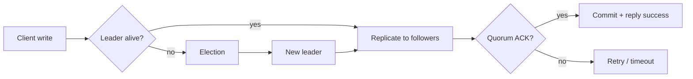
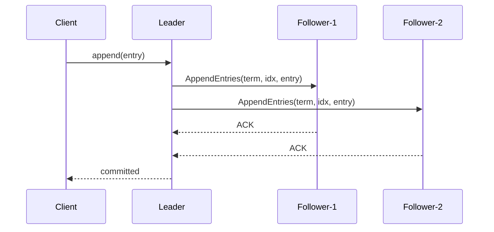
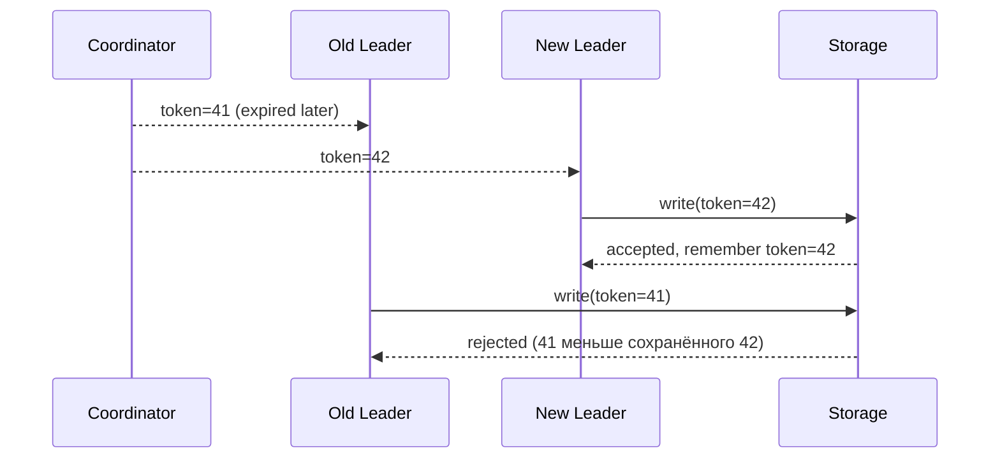
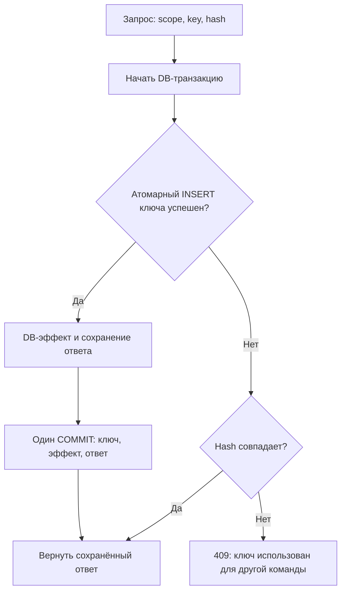

---
---

# Consensus и распределённая координация

## Содержание

1. [Актуальность материала](#актуальность-материала)
2. [Зачем это нужно](#зачем-это-нужно)
3. [Ключевые модели и гарантии](#ключевые-модели-и-гарантии)
4. [Raft на практике](#raft-на-практике)
5. [Паттерны лидерства и fencing](#паттерны-лидерства-и-fencing)
6. [Exactly-once: мифы и реальность](#exactly-once-мифы-и-реальность)
7. [Идемпотентность, дедупликация и replay](#идемпотентность-дедупликация-и-replay)
8. [Геораспределённый consensus и trade-offs](#геораспределённый-consensus-и-trade-offs)
9. [Практический чек-лист для production](#практический-чек-лист-для-production)
10. [Вопросы для самопроверки](#вопросы-для-самопроверки)
11. [Связанные материалы](#связанные-материалы)

<script type="module" src="../assets/mermaid-init.js"></script>

## Актуальность материала

- **Дата проверки:** 2026-10-15 — уточнены Raft, fencing и границы идемпотентности; остальные обзорные рекомендации ревизии 2026-08-04.
- **Целевая версия или диапазон:** Raft из исходной статьи; SQL-пример для PostgreSQL 18, схема протокола не зависит от языка приложения.
- **Статус примеров:** `current`; SQL — учебный фрагмент, а не готовая платёжная реализация.
- **Первичные источники:** [Raft, §5.2–5.4](https://raft.github.io/raft.pdf), [fencing и паузы процесса](https://martin.kleppmann.com/2016/02/08/how-to-do-distributed-locking.html), [PostgreSQL 18: INSERT / ON CONFLICT](https://www.postgresql.org/docs/18/sql-insert.html), [изоляция транзакций](https://www.postgresql.org/docs/18/transaction-iso.html), [Kafka 4.0: message delivery semantics](https://kafka.apache.org/40/design/design/#message-delivery-semantics).

## Зачем это нужно

Когда система перестаёт быть single-node, появляются проблемы координации:
- кто лидер и кто имеет право выполнять write-операции;
- как избежать split-brain;
- как сериализовать изменение критичных метаданных;
- как безопасно восстанавливаться после сетевых разделений.

> **Consensus** нужен не везде. Его применяют там, где ошибка координации дороже latency/сложности.

## Ключевые модели и гарантии

- **Safety**: «плохого» состояния не произойдёт. Например, в Raft не бывает двух избранных лидеров в одном term; старый лидер другого term при этом может ещё не знать о перевыборах.
- **Liveness**: система продолжит прогрессировать при выполнении предпосылок.
- **Linearizability**: операции выглядят как атомарно упорядоченные во времени.
- **Quorum**: набор участников, достаточный для операции по правилам протокола; в рассматриваемом Raft это большинство voting nodes: `floor(N / 2) + 1`.



## Raft на практике

Базовый цикл Raft: выбор лидера, репликация лога, commit по quorum. На схеме запись относится к текущему term лидера; для записей прошлых term действуют дополнительные правила §5.4 статьи. ACK означает предусмотренное протоколом сохранение записи, а не только получение пакета.



Практические нюансы:
- таймауты election и heartbeat должны иметь хороший jitter;
- snapshotting обязателен для длинных журналов;
- quorum-size влияет и на latency, и на fault tolerance.

## Паттерны лидерства и fencing

Даже с lease-lock возможны «старые» лидеры после пауз GC или сетевых проблем. Для защиты используют **fencing token**.



Хранилище должно атомарно сравнивать token с сохранённым максимумом и применять запись. Само получение `42` новым лидером ещё не сообщает об этом БД: до первой принятой записи с `42` проверка по максимуму может пропустить `41`. Если требуется немедленно отозвать старого владельца, перед началом работы новый лидер должен зарегистрировать эпоху в защищаемом хранилище либо использовать механизм проверки владения с необходимой согласованностью. Аннотация «lock acquired» без enforcement в write-path не защищает внешний эффект.

## Exactly-once: мифы и реальность

В распределённых системах «exactly-once end-to-end» почти всегда распадается на комбинацию:
- at-least-once доставка;
- idempotent processing;
- deduplication по ключу операции;
- transactional boundary (локальная или ограниченная внешняя).

**Практика:** называйте эффект, транзакционную границу и предпосылки. Например: «изменение строки и запись `(consumer, message_id)` коммитятся в одной PostgreSQL-транзакции; при повторной доставке тот же эффект не выполняется до удаления dedup-записи». Для Kafka read-process-write транзакции нужны согласованная запись результатов и offsets, а также соответствующий режим чтения. Произвольный HTTP-платёж в такую транзакцию не входит. Название consumer group или dedup-window само по себе не создаёт exactly-once.

## Идемпотентность, дедупликация и replay



Проверка «сначала SELECT, потом выполнить» не защищает от гонки. Локальный вариант использует уникальный ключ `(scope, key)`: `scope` включает tenant и операцию, hash считается по нормализованной команде и её версии. Ключ, бизнес-изменение, outbox и воспроизводимый ответ коммитятся вместе; HTTP-ответ отправляется после commit.

```sql
CREATE TABLE idempotency_request (
  scope text NOT NULL,
  key text NOT NULL,
  request_hash text NOT NULL,
  response jsonb,
  expires_at timestamptz NOT NULL,
  PRIMARY KEY (scope, key)
);

BEGIN;
INSERT INTO idempotency_request(scope, key, request_hash, expires_at)
VALUES ('tenant-7:create-order:v1', 'demo-key', 'canonical-payload-hash',
        now() + interval '7 days')
ON CONFLICT DO NOTHING
RETURNING key;
-- Есть строка в RETURNING: выполнить бизнес-DML, outbox и UPDATE response здесь.
-- Нет строки: отдельным SELECT в Read Committed прочитать запись конкурента,
-- сравнить hash и вернуть сохранённый ответ; не повторять бизнес-DML.
-- При lock timeout / serialization failure откатить и повторить всю транзакцию
-- с ограниченным retry budget, а не продолжать её с частичным результатом.
COMMIT;
```

Это псевдокод транзакционной границы: приложение должно реализовать ветвление и не коммитить владельца ключа без результата. Конкурирующий `INSERT` ждёт исхода другой транзакции; после её rollback один из запросов может стать владельцем. Для реального кода дополните ограничение времени ожидания, сохранение HTTP status/body и тест двух соединений. Удаление ключа по TTL завершает гарантию дедупликации: окно должно покрывать клиентские повторы и допустимый replay.

| Сбой | Проверяемый результат локального варианта |
|------|-----------------------------------------|
| Два запроса с одним scope/key и hash | Одна транзакция делает эффект, оба клиента получают один результат |
| Такой же ключ с другим hash | `409`, второй эффект отсутствует |
| Crash до commit, включая после бизнес-DML | Ключ, эффект и outbox откатываются вместе; повтор может выполнить команду |
| Commit прошёл, ответ потерян | Повтор читает сохранённый ответ; нового эффекта нет |
| Истёк dedup TTL | Повтор может считаться новой командой; это ограничение контракта |

**Внешний эффект:** не удерживайте DB-транзакцию во время сетевого платежа в надежде сделать её атомарной. Сначала коммитится durable intent/outbox. Worker передаёт стабильный business idempotency key провайдеру. При timeout после возможного списания он проверяет статус по этому ключу; до разрешения неоднозначности нельзя создавать новую операцию с новым ключом. Если провайдер не поддерживает такую сверку, гарантия должна явно допускать ручную reconciliation и возможные дубли/пропуски согласно бизнес-политике. См. [проверки практикума заказов](../практикумы/02-event-driven-обработка-заказов.html#приёмочные-сценарии).

Рекомендации:
- храните dedup-key в durable storage;
- фиксируйте TTL окна дедупликации;
- разделяйте business key и transport key;
- закладывайте replay-процедуры и backfill.

## Геораспределённый consensus и trade-offs

В multi-region quorum увеличивает RTT и снижает write-throughput.

| Стратегия | Плюсы | Минусы | Когда выбирать |
|-----------|-------|--------|----------------|
| Single-region leader | Низкая write latency | Слабее к региональным сбоям | Большинство workloads |
| Multi-region quorum | Выше устойчивость | Дороже по latency и ops | Критичные control-plane данные |
| Per-region leaders + async merge | Локальная скорость | Сложный conflict resolution | Глобальные read-heavy сценарии |

## Практический чек-лист для production

1. Определите, где нужен consensus, а где достаточно optimistic concurrency.
2. Зафиксируйте SLO для control-plane отдельно от data-plane.
3. Настройте fencing и monotonic tokens для всех write-path с лидерством.
4. Пропишите bootstrap/recovery runbook (потеря quorum, восстановление узла, reconfiguration).
5. Добавьте chaos-сценарии: network partition, clock skew, slow disk, paused process.

## Вопросы для самопроверки

1. Почему quorum «лечит» split-brain только при корректной конфигурации majority?
2. Чем lease без fencing опасен в production?
3. Когда «exactly-once» становится маркетинговым термином без инженерной ценности?
4. Какие метрики важнее всего для consensus-кластера (election rate, append latency, commit lag)?
5. В каких случаях не стоит использовать consensus-хранилище для бизнес-данных?

## Связанные материалы

- [Multi-region и geo-distributed системы](10-multi-region-и-geo-distributed-системы.html)
- [Асинхронность и событийные системы](05-асинхронность-и-событийные-системы.html)
- [CDC, event sourcing и materialized views](11-cdc-event-sourcing-и-materialized-views.html)
- [Масштабирование, надёжность и отказоустойчивость](06-масштабирование-надежность-и-отказоустойчивость.html)
