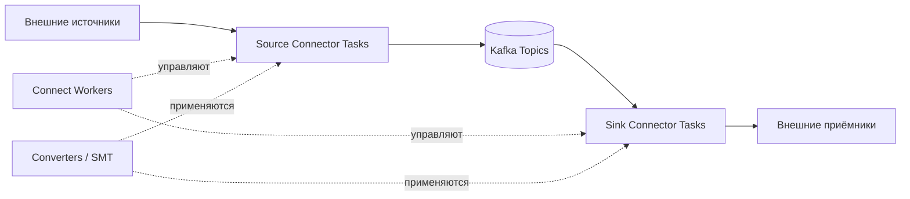

---
---

# Kafka Connect

## Содержание

1. [Актуальность материала](#актуальность-материала)
2. [Введение](#введение)
   - [Ключевые преимущества](#ключевые-преимущества)
3. [Архитектура](#архитектура)
   - [Компоненты](#компоненты)
   - [Режимы работы](#режимы-работы)
4. [Source Connectors](#source-connectors)
   - [JDBC Source Connector](#jdbc-source-connector)
   - [Debezium CDC Connectors](#debezium-cdc-connectors)
   - [FileStream Source Connector](#filestream-source-connector)
   - [S3 Source Connector](#s3-source-connector)
5. [Sink Connectors](#sink-connectors)
   - [JDBC Sink Connector](#jdbc-sink-connector)
   - [Elasticsearch Sink Connector](#elasticsearch-sink-connector)
   - [S3 Sink Connector](#s3-sink-connector)
   - [HDFS Sink Connector](#hdfs-sink-connector)
6. [Single Message Transforms (SMT)](#single-message-transforms-smt)
   - [InsertField](#insertfield)
   - [ReplaceField](#replacefield)
   - [MaskField](#maskfield)
   - [Filter](#filter)
   - [TimestampConverter](#timestampconverter)
   - [Flatten](#flatten)
   - [Chain трансформаций](#chain-трансформаций)
7. [Converters и Serialization](#converters-и-serialization)
   - [Доступные Converters](#доступные-converters)
8. [Управление коннекторами](#управление-коннекторами)
   - [REST API](#rest-api)
9. [Конфигурация Worker](#конфигурация-worker)
   - [Distributed Mode Config](#distributed-mode-config)
10. [Мониторинг и метрики](#мониторинг-и-метрики)
   - [JMX Метрики](#jmx-метрики)
   - [Логирование](#логирование)
11. [Best Practices](#best-practices)
   - [1. Настройка количества задач](#1-настройка-количества-задач)
   - [2. Batch конфигурация](#2-batch-конфигурация)
   - [3. Error handling](#3-error-handling)
   - [4. Использование Schema Registry](#4-использование-schema-registry)
   - [5. Мониторинг lag](#5-мониторинг-lag)
12. [Практический пример: PostgreSQL → Kafka → Elasticsearch](#практический-пример-postgresql--kafka--elasticsearch)
   - [1. Source Connector (PostgreSQL)](#1-source-connector-postgresql)
   - [2. Sink Connector (Elasticsearch)](#2-sink-connector-elasticsearch)
   - [3. Проверка поведения и восстановления](#3-проверка-поведения-и-восстановления)
13. [Вопросы для самопроверки](#вопросы-для-самопроверки)

## Актуальность материала

- **Дата проверки исправленных разделов:** 2026-10-15 (Debezium properties, task model, converters и delete contract); предыдущая общая проверка — 2026-08-04.
- **Целевая версия или диапазон:** Kafka Connect 4.0; конфигурационный baseline Debezium PostgreSQL 3.0.x, JDBC connector 10.9.9, Elasticsearch sink 16.0.0 (Elasticsearch 8.x/9.x).
- **Статус примеров:** `preview` для полного стороннего pipeline: конфигурации сверены по источникам, совместный deployment перечисленных plugins не запускался. S3/HDFS — обзорные эскизы до фиксации версии конкретного plugin.
- **Первичные источники:** [Debezium PostgreSQL 3.0](https://debezium.io/documentation/reference/3.0/connectors/postgresql.html), [ExtractNewRecordState](https://debezium.io/documentation/reference/3.0/transformations/event-flattening.html), [Elasticsearch config](https://docs.confluent.io/kafka-connectors/elasticsearch/current/configuration_options.html), [Elasticsearch 16.0 changelog](https://docs.confluent.io/kafka-connectors/elasticsearch/current/changelog.html), [JDBC 10.9 changelog](https://docs.confluent.io/kafka-connectors/jdbc/current/changelog.html). Версии broker, worker, plugin и целевой системы фиксируют независимо.

## Введение

**Kafka Connect** — это фреймворк для масштабируемой и надёжной интеграции Apache Kafka с внешними системами (базами данных, файловыми системами, облачными сервисами и другими источниками/приёмниками данных). Connect упрощает построение data pipelines без необходимости писать и поддерживать собственный код для интеграции.

### Ключевые преимущества

- **Готовые коннекторы**: Сотни коннекторов для популярных систем (PostgreSQL, MongoDB, S3, Elasticsearch и др.)
- **Масштабируемость**: Распределённая архитектура с автоматической балансировкой нагрузки
- **Fault tolerance**: Автоматическое восстановление при сбоях
- **Без кода**: Конфигурация через JSON, минимум или отсутствие кастомного кода
- **Трансформации**: Встроенные Single Message Transforms (SMT) для простых преобразований данных
- **Мониторинг**: Интеграция с JMX для отслеживания метрик

## Архитектура

### Компоненты



**Workers**
- Процессы, выполняющие коннекторы и задачи
- Могут работать в standalone или distributed режиме
- Управляют lifecycle коннекторов и задач

**Connectors**
- Определяют, какие данные нужно копировать
- Конфигурируют и управляют задачами (tasks)
- Типы: Source (чтение из внешних систем) и Sink (запись в внешние системы)

**Tasks**
- Фактически выполняют работу по копированию данных
- Создаются и управляются коннекторами
- Могут быть распределены по разным workers

**Converters**
- Преобразуют данные между форматами Kafka Connect и Kafka (JSON, Avro, Protobuf)
- Независимы от коннекторов

**Transforms**
- Single Message Transforms (SMT) для простых преобразований данных
- Применяются к отдельным сообщениям

### Режимы работы

**Standalone Mode**
```bash
# Простой режим для разработки и тестирования
# Все коннекторы и задачи выполняются в одном процессе
connect-standalone.sh connect-standalone.properties connector1.properties
```

**Distributed Mode**
```bash
# Производственный режим
# Распределённая архитектура с балансировкой нагрузки и fault tolerance
connect-distributed.sh connect-distributed.properties

# Коннекторы добавляются через REST API
curl -X POST http://localhost:8083/connectors \
  -H "Content-Type: application/json" \
  -d @connector-config.json
```

## Source Connectors

Source коннекторы читают данные из внешних систем и записывают их в Kafka.

### JDBC Source Connector

**Конфигурация**
```json
{
  "name": "postgres-source",
  "config": {
    "connector.class": "io.confluent.connect.jdbc.JdbcSourceConnector",
    "tasks.max": "1",
    "connection.url": "jdbc:postgresql://localhost:5432/mydb",
    "connection.user": "user",
    "connection.password": "password",
    "table.whitelist": "orders,customers",
    "mode": "incrementing",
    "incrementing.column.name": "id",
    "topic.prefix": "postgres-",
    "poll.interval.ms": "1000"
  }
}
```

**Режимы работы**
- **incrementing**: Использует auto-increment колонку для отслеживания новых записей
- **timestamp**: Использует timestamp колонку для отслеживания изменений
- **timestamp+incrementing**: Комбинация обоих подходов
- **bulk**: Копирует всю таблицу каждый раз (для маленьких справочных таблиц)

**Пример: Timestamp mode**
```json
{
  "name": "postgres-timestamp-source",
  "config": {
    "connector.class": "io.confluent.connect.jdbc.JdbcSourceConnector",
    "connection.url": "jdbc:postgresql://localhost:5432/mydb",
    "mode": "timestamp",
    "timestamp.column.name": "updated_at",
    "validate.non.null": "false",
    "topic.prefix": "db-"
  }
}
```

### Debezium CDC Connectors

Change Data Capture для PostgreSQL, MySQL, MongoDB и других СУБД.

**PostgreSQL CDC**
```json
{
  "name": "debezium-postgres-connector",
  "config": {
    "connector.class": "io.debezium.connector.postgresql.PostgresConnector",
    "database.hostname": "localhost",
    "database.port": "5432",
    "database.user": "postgres",
    "database.password": "password",
    "database.dbname": "mydb",
    "topic.prefix": "postgres-server",
    "table.include.list": "public.orders,public.customers",
    "plugin.name": "pgoutput",
    "publication.autocreate.mode": "filtered",
    "snapshot.mode": "initial"
  }
}
```

**Snapshot режимы**
- `initial`: Начальный снимок, затем CDC
- `no_data`: Не копировать строки начального snapshot; корректная стартовая позиция и сохранность WAL всё равно обязательны
- `when_needed`: Снимок при необходимости
- `always`: Всегда делать снимок

### FileStream Source Connector

Простой коннектор для чтения файлов (полезен для тестирования).

```json
{
  "name": "file-source",
  "config": {
    "connector.class": "FileStreamSource",
    "tasks.max": "1",
    "file": "/tmp/input.txt",
    "topic": "file-topic"
  }
}
```

### S3 Source Connector

Эскиз стороннего plugin: classname, license, доступные formats и параметры зависят от поставщика и версии. Перед запуском закрепите artifact/version и выполните REST config validation; это не встроенный Apache connector.

```json
{
  "name": "s3-source",
  "config": {
    "connector.class": "io.confluent.connect.s3.source.S3SourceConnector",
    "tasks.max": "1",
    "s3.region": "us-west-2",
    "s3.bucket.name": "my-bucket",
    "topics.dir": "kafka-topics",
    "format.class": "io.confluent.connect.s3.format.json.JsonFormat",
    "confluent.topic.bootstrap.servers": "localhost:9092"
  }
}
```

## Sink Connectors

Sink коннекторы читают данные из Kafka и записывают их во внешние системы.

### JDBC Sink Connector

Для `record_key`/`record_value` и автоматического DDL требуется подходящая Connect schema. JSON без schemas не равен schemaful Connect Struct. `auto.create`/`auto.evolve` ниже удобны в учебном стенде; production DDL обычно проходит отдельно через migrations.

```json
{
  "name": "postgres-sink",
  "config": {
    "connector.class": "io.confluent.connect.jdbc.JdbcSinkConnector",
    "tasks.max": "3",
    "topics": "orders,customers",
    "connection.url": "jdbc:postgresql://localhost:5432/targetdb",
    "connection.user": "user",
    "connection.password": "password",
    "auto.create": "true",
    "auto.evolve": "true",
    "insert.mode": "upsert",
    "pk.mode": "record_key",
    "pk.fields": "id",
    "table.name.format": "${topic}"
  }
}
```

**Insert режимы**
- `insert`: Простая вставка (может привести к дубликатам)
- `upsert`: INSERT или UPDATE (требует PK)
- `update`: Только UPDATE

**PK режимы**
- `none`: Без первичного ключа
- `kafka`: Использовать координаты Kafka (topic, partition, offset)
- `record_key`: Использовать ключ записи
- `record_value`: Извлечь PK из значения

### Elasticsearch Sink Connector

```json
{
  "name": "elasticsearch-sink",
  "config": {
    "connector.class": "io.confluent.connect.elasticsearch.ElasticsearchSinkConnector",
    "tasks.max": "3",
    "topics": "orders,customers",
    "connection.url": "http://localhost:9200",
    "key.ignore": "false",
    "schema.ignore": "true",
    "behavior.on.null.values": "DELETE",
    "batch.size": "2000",
    "max.buffered.records": "20000"
  }
}
```

### S3 Sink Connector

```json
{
  "name": "s3-sink",
  "config": {
    "connector.class": "io.confluent.connect.s3.S3SinkConnector",
    "tasks.max": "3",
    "topics": "orders",
    "s3.region": "us-west-2",
    "s3.bucket.name": "my-data-lake",
    "s3.part.size": "5242880",
    "flush.size": "1000",
    "storage.class": "io.confluent.connect.s3.storage.S3Storage",
    "format.class": "io.confluent.connect.s3.format.parquet.ParquetFormat",
    "partitioner.class": "io.confluent.connect.storage.partitioner.TimeBasedPartitioner",
    "partition.duration.ms": "3600000",
    "path.format": "'year'=YYYY/'month'=MM/'day'=dd/'hour'=HH",
    "locale": "en-US",
    "timezone": "UTC"
  }
}
```

### HDFS Sink Connector

```json
{
  "name": "hdfs-sink",
  "config": {
    "connector.class": "io.confluent.connect.hdfs.HdfsSinkConnector",
    "tasks.max": "3",
    "topics": "orders",
    "hdfs.url": "hdfs://namenode:8020",
    "flush.size": "1000",
    "format.class": "io.confluent.connect.hdfs.parquet.ParquetFormat",
    "partitioner.class": "io.confluent.connect.storage.partitioner.HourlyPartitioner",
    "rotate.interval.ms": "3600000"
  }
}
```

## Single Message Transforms (SMT)

Встроенные трансформации для простых преобразований данных.

### InsertField

Добавление полей к сообщению:

```json
{
  "transforms": "InsertTimestamp,InsertSource",
  "transforms.InsertTimestamp.type": "org.apache.kafka.connect.transforms.InsertField$Value",
  "transforms.InsertTimestamp.timestamp.field": "ingestion_time",
  "transforms.InsertSource.type": "org.apache.kafka.connect.transforms.InsertField$Value",
  "transforms.InsertSource.static.field": "source_system",
  "transforms.InsertSource.static.value": "postgres"
}
```

### ReplaceField

Переименование или удаление полей:

```json
{
  "transforms": "RenameField",
  "transforms.RenameField.type": "org.apache.kafka.connect.transforms.ReplaceField$Value",
  "transforms.RenameField.renames": "old_name:new_name,another_old:another_new",
  "transforms.RenameField.exclude": "sensitive_field,temp_field"
}
```

### MaskField

Маскирование чувствительных данных:

```json
{
  "transforms": "MaskSensitive",
  "transforms.MaskSensitive.type": "org.apache.kafka.connect.transforms.MaskField$Value",
  "transforms.MaskSensitive.fields": "password,credit_card",
  "transforms.MaskSensitive.replacement": "***MASKED***"
}
```

### Filter

Фильтрация сообщений:

```json
{
  "transforms": "FilterByType",
  "transforms.FilterByType.type": "org.apache.kafka.connect.transforms.Filter",
  "transforms.FilterByType.predicate": "isDeleteEvent",
  "predicates": "isDeleteEvent",
  "predicates.isDeleteEvent.type": "org.apache.kafka.connect.transforms.predicates.RecordIsTombstone"
}
```

### TimestampConverter

Преобразование форматов времени:

```json
{
  "transforms": "ConvertTimestamp",
  "transforms.ConvertTimestamp.type": "org.apache.kafka.connect.transforms.TimestampConverter$Value",
  "transforms.ConvertTimestamp.field": "created_at",
  "transforms.ConvertTimestamp.format": "yyyy-MM-dd'T'HH:mm:ss.SSS'Z'",
  "transforms.ConvertTimestamp.target.type": "Timestamp"
}
```

### Flatten

Преобразование вложенных структур в плоские:

```json
{
  "transforms": "Flatten",
  "transforms.Flatten.type": "org.apache.kafka.connect.transforms.Flatten$Value",
  "transforms.Flatten.delimiter": "_"
}
```

### Chain трансформаций

```json
{
  "transforms": "InsertTimestamp,MaskSensitive,Flatten",
  "transforms.InsertTimestamp.type": "org.apache.kafka.connect.transforms.InsertField$Value",
  "transforms.InsertTimestamp.timestamp.field": "processed_at",
  "transforms.MaskSensitive.type": "org.apache.kafka.connect.transforms.MaskField$Value",
  "transforms.MaskSensitive.fields": "ssn,password",
  "transforms.Flatten.type": "org.apache.kafka.connect.transforms.Flatten$Value"
}
```

## Converters и Serialization

### Доступные Converters

**JSON Converter**
```json
{
  "key.converter": "org.apache.kafka.connect.json.JsonConverter",
  "key.converter.schemas.enable": "false",
  "value.converter": "org.apache.kafka.connect.json.JsonConverter",
  "value.converter.schemas.enable": "false"
}
```

**Avro Converter (с Schema Registry)**
```json
{
  "key.converter": "io.confluent.connect.avro.AvroConverter",
  "key.converter.schema.registry.url": "http://localhost:8081",
  "value.converter": "io.confluent.connect.avro.AvroConverter",
  "value.converter.schema.registry.url": "http://localhost:8081"
}
```

**Protobuf Converter**
```json
{
  "value.converter": "io.confluent.connect.protobuf.ProtobufConverter",
  "value.converter.schema.registry.url": "http://localhost:8081"
}
```

**String Converter**
```json
{
  "key.converter": "org.apache.kafka.connect.storage.StringConverter",
  "value.converter": "org.apache.kafka.connect.storage.StringConverter"
}
```

**ByteArray Converter**
```json
{
  "key.converter": "org.apache.kafka.connect.converters.ByteArrayConverter",
  "value.converter": "org.apache.kafka.connect.converters.ByteArrayConverter"
}
```

## Управление коннекторами

### REST API

**Получить список коннекторов**
```bash
curl http://localhost:8083/connectors
```

**Получить статус коннектора**
```bash
curl http://localhost:8083/connectors/postgres-source/status
```

**Создать коннектор**
```bash
curl -X POST http://localhost:8083/connectors \
  -H "Content-Type: application/json" \
  -d @connector-config.json
```

**Обновить конфигурацию**
```bash
curl -X PUT http://localhost:8083/connectors/postgres-source/config \
  -H "Content-Type: application/json" \
  -d @new-config.json
```

**Пауза коннектора**
```bash
curl -X PUT http://localhost:8083/connectors/postgres-source/pause
```

**Возобновление коннектора**
```bash
curl -X PUT http://localhost:8083/connectors/postgres-source/resume
```

**Перезапуск коннектора**
```bash
curl -X POST http://localhost:8083/connectors/postgres-source/restart
```

**Перезапуск задачи**
```bash
curl -X POST http://localhost:8083/connectors/postgres-source/tasks/0/restart
```

**Удаление коннектора**
```bash
curl -X DELETE http://localhost:8083/connectors/postgres-source
```

**Получить конфигурацию**
```bash
curl http://localhost:8083/connectors/postgres-source/config
```

**Валидация конфигурации**
```bash
curl -X PUT http://localhost:8083/connector-plugins/JdbcSourceConnector/config/validate \
  -H "Content-Type: application/json" \
  -d @connector-config.json
```

## Конфигурация Worker

### Distributed Mode Config

```properties
# connect-distributed.properties

# Bootstrap servers
bootstrap.servers=localhost:9092

# Уникальный ID для cluster
group.id=connect-cluster

# Топики для хранения конфигураций, смещений и статусов
config.storage.topic=connect-configs
config.storage.replication.factor=3

offset.storage.topic=connect-offsets
offset.storage.replication.factor=3
offset.storage.partitions=25

status.storage.topic=connect-status
status.storage.replication.factor=3
status.storage.partitions=5

# Converters по умолчанию
key.converter=org.apache.kafka.connect.json.JsonConverter
value.converter=org.apache.kafka.connect.json.JsonConverter
key.converter.schemas.enable=true
value.converter.schemas.enable=true

# REST API
listeners=http://0.0.0.0:8083
rest.advertised.host.name=localhost

# Plugin path
plugin.path=/usr/share/java,/usr/local/share/kafka/plugins

# Настройки производительности
offset.flush.interval.ms=10000
offset.flush.timeout.ms=5000

# Heartbeat
heartbeat.interval.ms=3000
session.timeout.ms=30000
```

## Мониторинг и метрики

### JMX Метрики

**Connector Metrics**
- `connector-total-task-count`: Общее количество задач
- `connector-running-task-count`: Количество запущенных задач
- `connector-paused-task-count`: Количество приостановленных задач
- `connector-failed-task-count`: Количество упавших задач

**Task Metrics**
- `source-record-poll-rate`: Скорость чтения записей (source)
- `source-record-write-rate`: Скорость записи в Kafka (source)
- `sink-record-read-rate`: Скорость чтения из Kafka (sink)
- `sink-record-send-rate`: Скорость записи в целевую систему (sink)

**Worker Metrics**
- `task-count`: Количество задач на worker
- `connector-count`: Количество коннекторов на worker
- `task-startup-attempts-total`: Попытки запуска задач
- `task-startup-failure-total`: Неудачные запуски

### Логирование

```properties
# log4j.properties для Connect
log4j.rootLogger=INFO, stdout

log4j.appender.stdout=org.apache.log4j.ConsoleAppender
log4j.appender.stdout.layout=org.apache.log4j.PatternLayout
log4j.appender.stdout.layout.ConversionPattern=[%d] %p %m (%c)%n

# Детальное логирование для конкретного коннектора
log4j.logger.io.confluent.connect.jdbc=DEBUG
```

## Best Practices

### 1. Настройка количества задач

```json
{
  "tasks.max": "3"
}
```
- Количество задач <= количество партиций топика (для sink)
- Для source task model задаёт plugin: JDBC может распределять таблицы между tasks; Debezium PostgreSQL использует **одну task на connector**, даже при многих таблицах. Увеличение `tasks.max` это не меняет. Другие Debezium connectors имеют свою модель.

### 2. Batch конфигурация

```json
{
  "batch.size": "2000",
  "max.buffered.records": "20000",
  "linger.ms": "1000"
}
```

### 3. Error handling

```json
{
  "errors.tolerance": "all",
  "errors.log.enable": "true",
  "errors.log.include.messages": "false",
  "errors.deadletterqueue.topic.name": "dlq-topic",
  "errors.deadletterqueue.topic.replication.factor": "3",
  "errors.deadletterqueue.context.headers.enable": "true"
}
```

`errors.tolerance=all` допускает пропуск поддерживаемых framework стадиями ошибок, а не делает любые ошибки внешней системы безвредными. DLQ не является автоматическим retry: нужны owner, alert и процедура исправления/replay. Не включайте payload в production logs без необходимости.

### 4. Использование Schema Registry

```json
{
  "value.converter": "io.confluent.connect.avro.AvroConverter",
  "value.converter.schema.registry.url": "http://localhost:8081",
  "value.converter.enhanced.avro.schema.support": "true"
}
```

### 5. Мониторинг lag

- Следите за `source-record-poll-rate` и `sink-record-send-rate`
- Алерты на высокий `consumer-lag` для sink коннекторов
- Мониторинг `task-startup-failure-total`

## Практический пример: PostgreSQL → Kafka → Elasticsearch

Контракт: `public.orders(id bigint PRIMARY KEY, status text)` → topic `ecommerce-db.public.orders` → index `orders`, document ID равен `id`. Raw Debezium envelope сохраняется в Kafka; unwrap выполняется на sink. Компоненты используют одинаковый schemaful JSON wire format. Пример не задаёт production PKI/secret management.

До регистрации connectors: установите plugins в `plugin.path` и проверьте `/connector-plugins`; настройте `wal_level=logical`, свободные replication slots/walsenders, отдельного replication user с LOGIN/REPLICATION/SELECT. Администратор создаёт publication `orders_publication` для `public.orders` и выдаёт необходимые права; ниже autocreate отключён. Проверьте retained WAL и уникальность `slot.name`; пароли замените ConfigProvider references. Debezium SMT должен быть доступен и sink worker.

### 1. Source Connector (PostgreSQL)

```json
{
  "name": "postgres-orders-source",
  "config": {
    "connector.class": "io.debezium.connector.postgresql.PostgresConnector",
    "database.hostname": "postgres-db",
    "database.port": "5432",
    "database.user": "kafka_user",
    "database.password": "kafka_pass",
    "database.dbname": "ecommerce",
    "topic.prefix": "ecommerce-db",
    "table.include.list": "public.orders",
    "plugin.name": "pgoutput",
    "slot.name": "orders_cdc",
    "publication.name": "orders_publication",
    "publication.autocreate.mode": "disabled",
    "snapshot.mode": "initial",
    "tombstones.on.delete": "true",
    "key.converter": "org.apache.kafka.connect.json.JsonConverter",
    "value.converter": "org.apache.kafka.connect.json.JsonConverter",
    "key.converter.schemas.enable": "true",
    "value.converter.schemas.enable": "true"
  }
}
```

### 2. Sink Connector (Elasticsearch)

```json
{
  "name": "elasticsearch-orders-sink",
  "config": {
    "connector.class": "io.confluent.connect.elasticsearch.ElasticsearchSinkConnector",
    "tasks.max": "3",
    "topics": "ecommerce-db.public.orders",
    "connection.url": "http://elasticsearch:9200",
    "key.ignore": "false",
    "schema.ignore": "true",
    "behavior.on.null.values": "DELETE",
    "key.converter": "org.apache.kafka.connect.json.JsonConverter",
    "value.converter": "org.apache.kafka.connect.json.JsonConverter",
    "key.converter.schemas.enable": "true",
    "value.converter.schemas.enable": "true",
    "batch.size": "1000",
    "max.in.flight.requests": "1",
    "flush.synchronously": "true",
    "errors.tolerance": "none",
    "errors.deadletterqueue.topic.name": "dlq-elasticsearch-orders",
    "transforms": "unwrap,extractId,route",
    "transforms.unwrap.type": "io.debezium.transforms.ExtractNewRecordState",
    "transforms.unwrap.delete.tombstone.handling.mode": "tombstone",
    "transforms.extractId.type": "org.apache.kafka.connect.transforms.ExtractField$Key",
    "transforms.extractId.field": "id",
    "transforms.route.type": "org.apache.kafka.connect.transforms.RegexRouter",
    "transforms.route.regex": ".*\\.(.*)",
    "transforms.route.replacement": "$1"
  }
}
```

`flush.synchronously=true` нужен при маршрутизации topic через RegexRouter; один in-flight batch упрощает сохранение порядка обновлений документа. Для sink 16.0 `type.name` из старых Elasticsearch API не нужен. До создания connector проверьте config через `PUT /connector-plugins/{connectorType}/config/validate`; ноль ошибок не доказывает доступность БД или корректность событий.

### 3. Проверка поведения и восстановления

1. INSERT `id=42,status='created'`: дождаться документа `orders/42` с этим status.
2. UPDATE на `paid`: убедиться, что изменился тот же document ID и второго документа не появилось.
3. DELETE: source выдаёт delete envelope и tombstone; sink unwrap оставляет tombstone, затем `behavior.on.null.values=DELETE` удаляет document.
4. Перезапустить worker между записью и фиксацией offsets; после восстановления повторные события должны сходиться к тому же состоянию. Upsert/delete помогают этому сценарию, но не означают атомарную транзакцию Kafka+Elasticsearch.
5. На отдельном fixture topic отправить запись с ошибочным типом ключа и проверить наблюдаемый отказ task. Отдельно включить DLQ/tolerance для поддерживаемой ошибки conversion, проверить запись в DLQ, alert и управляемый replay; не смешивать этот эксперимент с production CDC topic.

Для каждого шага сохраняйте source LSN, Kafka key/offset и результат чтения index. После теста остановите connector до удаления его replication slot; убедитесь, что slot больше никем не используется. Потеря slot/WAL может потребовать нового snapshot и сверки состояния.

## Вопросы для самопроверки

1. **В чем разница между standalone и distributed режимами?**
   - Standalone: один процесс, для разработки; Distributed: кластер с fault tolerance

2. **Как масштабировать Kafka Connect?**
   - Добавить workers в distributed кластер, увеличить tasks.max

3. **Что такое SMT и когда их использовать?**
   - Single Message Transforms для простых преобразований данных без написания кода

4. **Как обрабатывать ошибки в коннекторах?**
   - Настроить errors.tolerance, DLQ топик, логирование

5. **Зачем нужен Schema Registry?**
   - Централизованное управление схемами, эволюция схем, совместимость

6. **Как обеспечить exactly-once для sink коннекторов?**
   - Универсальной атомарной транзакции Kafka+любая цель нет. Гарантия зависит от plugin и target; upsert с устойчивым ключом обеспечивает идемпотентный итог лишь при нужном порядке и семантике обновлений. Проверяйте crash/replay контракт.

7. **В чем разница между JDBC Source и Debezium?**
   - JDBC: polling-based, видит только текущее состояние; Debezium: CDC, видит все изменения

8. **Как мониторить производительность коннекторов?**
   - JMX метрики, логи, consumer lag для sink коннекторов

9. **Что делать если коннектор падает?**
   - Проверить логи, статус через REST API, перезапустить коннектор/задачу

10. **Как организовать CI/CD для коннекторов?**
    - Хранить конфигурации в git, автоматизировать деплой через REST API, тестировать в staging
