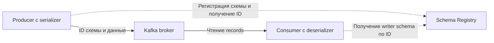

---
---

# Schema Registry и управление схемами

## Содержание

1. [Актуальность материала](#актуальность-материала)
2. [Введение](#введение)
   - [Зачем нужен Schema Registry](#зачем-нужен-schema-registry)
   - [Основные возможности](#основные-возможности)
3. [Архитектура](#архитектура)
   - [Компоненты](#компоненты)
   - [Subject и версии](#subject-и-версии)
4. [Форматы схем](#форматы-схем)
   - [Apache Avro](#apache-avro)
   - [Protocol Buffers (Protobuf)](#protocol-buffers-protobuf)
   - [JSON Schema](#json-schema)
5. [Режимы совместимости](#режимы-совместимости)
   - [Backward Compatibility (по умолчанию)](#backward-compatibility-по-умолчанию)
   - [Forward Compatibility](#forward-compatibility)
   - [Full Compatibility](#full-compatibility)
   - [None](#none)
   - [Transitive совместимость](#transitive-совместимость)
6. [REST API](#rest-api)
   - [Управление схемами](#управление-схемами)
   - [Управление совместимостью](#управление-совместимостью)
7. [Эволюция схем](#эволюция-схем)
   - [Добавление полей](#добавление-полей)
   - [Удаление полей](#удаление-полей)
   - [Изменение типов](#изменение-типов)
   - [Union типы](#union-типы)
8. [Конфигурация Schema Registry](#конфигурация-schema-registry)
   - [Основные параметры](#основные-параметры)
   - [High Availability](#high-availability)
9. [Best Practices](#best-practices)
   - [1. Именование subject](#1-именование-subject)
   - [2. Использование namespaces](#2-использование-namespaces)
   - [3. Документирование схем](#3-документирование-схем)
   - [4. Версионирование](#4-версионирование)
   - [5. Default значения](#5-default-значения)
   - [6. Логические типы](#6-логические-типы)
10. [Мониторинг](#мониторинг)
   - [JMX Метрики](#jmx-метрики)
   - [Health Check](#health-check)
   - [Prometheus интеграция](#prometheus-интеграция)
11. [Тестирование](#тестирование)
   - [Unit тесты со схемами](#unit-тесты-со-схемами)
   - [Mock Schema Registry для тестов](#mock-schema-registry-для-тестов)
12. [Вопросы для самопроверки](#вопросы-для-самопроверки)

## Актуальность материала

- **Дата проверки исправленных разделов:** 2026-10-15 (compatibility, Avro types и тесты); предыдущая общая проверка — 2026-08-04.
- **Целевая версия или диапазон:** Avro 1.12.0; Confluent Schema Registry REST API 7.9. Версия broker не определяет версию Schema Registry или serializer.
- **Статус примеров:** `current`
- **Первичные источники:** [Confluent 7.9: Schema Evolution](https://docs.confluent.io/platform/7.9/schema-registry/fundamentals/schema-evolution.html), [REST API](https://docs.confluent.io/platform/7.9/schema-registry/develop/api.html), [Avro 1.12: Schema Resolution](https://avro.apache.org/docs/1.12.0/specification/#schema-resolution), [Monitoring](https://docs.confluent.io/platform/7.9/schema-registry/monitoring.html). Проверка reader/writer в примерах не является проверкой запущенного Registry.

## Введение

**Confluent Schema Registry** — это сервис для централизованного управления и хранения схем данных для Apache Kafka. Он обеспечивает слой управления схемами для Avro, Protobuf и JSON Schema, позволяя производителям и потребителям обмениваться данными с гарантией совместимости.

### Зачем нужен Schema Registry

- **Централизация**: Единое хранилище схем для всей организации
- **Совместимость**: Контроль эволюции схем с проверкой совместимости
- **Эффективность**: Хранение только ID схемы в сообщении вместо полной схемы
- **Безопасность типов**: Валидация данных при сериализации/десериализации
- **Документация**: Схемы служат живой документацией формата данных

### Основные возможности

- Хранение версий схем для каждого subject
- Проверка совместимости при регистрации новых схем
- RESTful API для управления схемами
- Поддержка нескольких форматов: Avro, Protobuf, JSON Schema
- Режимы совместимости: backward, forward, full, none
- Интеграция с Kafka producers/consumers через сериализаторы

## Архитектура

### Компоненты



<script type="module" src="../../assets/mermaid-init.js"></script>

Registry обслуживает схемы; payload producer отправляет непосредственно broker. Кэширование схем клиентом уменьшает число REST-вызовов, но startup/new schema всё ещё зависят от доступности Registry.

### Subject и версии

**Subject** — это scope, в котором хранятся версии схем. Обычно subject = topic name + "-key" или "-value".

Пример:
- `orders-value`: схемы для значений в топике orders
- `orders-key`: схемы для ключей в топике orders

Каждая регистрация новой схемы создаёт новую версию в рамках subject.

## Форматы схем

### Apache Avro

**Преимущества**
- Компактная бинарная сериализация
- Встроенная поддержка эволюции схем
- Схема описывается в JSON

**Пример схемы**
```json
{
  "type": "record",
  "name": "Order",
  "namespace": "com.example.orders",
  "fields": [
    {
      "name": "orderId",
      "type": "string"
    },
    {
      "name": "customerId",
      "type": "string"
    },
    {
      "name": "amount",
      "type": "double"
    },
    {
      "name": "status",
      "type": {
        "type": "enum",
        "name": "OrderStatus",
        "symbols": ["PENDING", "CONFIRMED", "SHIPPED", "DELIVERED"]
      }
    },
    {
      "name": "createdAt",
      "type": "long",
      "logicalType": "timestamp-millis"
    }
  ]
}
```

**Пример использования в Java**
```java
// Producer
Properties props = new Properties();
props.put(ProducerConfig.BOOTSTRAP_SERVERS_CONFIG, "localhost:9092");
props.put(ProducerConfig.KEY_SERIALIZER_CLASS_CONFIG, 
    StringSerializer.class);
props.put(ProducerConfig.VALUE_SERIALIZER_CLASS_CONFIG, 
    KafkaAvroSerializer.class);
props.put("schema.registry.url", "http://localhost:8081");

KafkaProducer<String, Order> producer = new KafkaProducer<>(props);

Order order = Order.newBuilder()
    .setOrderId("ORDER-123")
    .setCustomerId("CUST-456")
    .setAmount(99.99)
    .setStatus(OrderStatus.PENDING)
    .setCreatedAt(System.currentTimeMillis())
    .build();

producer.send(new ProducerRecord<>("orders", order.getOrderId(), order));

// Consumer
Properties consumerProps = new Properties();
consumerProps.put(ConsumerConfig.BOOTSTRAP_SERVERS_CONFIG, "localhost:9092");
consumerProps.put(ConsumerConfig.GROUP_ID_CONFIG, "order-consumers");
consumerProps.put(ConsumerConfig.KEY_DESERIALIZER_CLASS_CONFIG, 
    StringDeserializer.class);
consumerProps.put(ConsumerConfig.VALUE_DESERIALIZER_CLASS_CONFIG, 
    KafkaAvroDeserializer.class);
consumerProps.put("schema.registry.url", "http://localhost:8081");
consumerProps.put(KafkaAvroDeserializerConfig.SPECIFIC_AVRO_READER_CONFIG, true);

KafkaConsumer<String, Order> consumer = new KafkaConsumer<>(consumerProps);
consumer.subscribe(Collections.singletonList("orders"));
```

### Protocol Buffers (Protobuf)

**Преимущества**
- Очень компактная сериализация
- Высокая производительность
- Кроссплатформенность
- Широкая поддержка языков

**Пример схемы**
```protobuf
syntax = "proto3";

package com.example.orders;

message Order {
  string order_id = 1;
  string customer_id = 2;
  double amount = 3;
  OrderStatus status = 4;
  int64 created_at = 5;
  
  enum OrderStatus {
    PENDING = 0;
    CONFIRMED = 1;
    SHIPPED = 2;
    DELIVERED = 3;
  }
}
```

**Использование**
```java
props.put(ProducerConfig.VALUE_SERIALIZER_CLASS_CONFIG, 
    KafkaProtobufSerializer.class);
props.put("schema.registry.url", "http://localhost:8081");

// Deserialization
consumerProps.put(ConsumerConfig.VALUE_DESERIALIZER_CLASS_CONFIG, 
    KafkaProtobufDeserializer.class);
consumerProps.put(KafkaProtobufDeserializerConfig.SPECIFIC_PROTOBUF_VALUE_TYPE, 
    Order.class);
```

### JSON Schema

**Преимущества**
- Читаемый формат
- Легко отлаживать
- Широкая поддержка инструментов

**Пример схемы**
```json
{
  "$schema": "http://json-schema.org/draft-07/schema#",
  "title": "Order",
  "type": "object",
  "properties": {
    "orderId": {
      "type": "string"
    },
    "customerId": {
      "type": "string"
    },
    "amount": {
      "type": "number"
    },
    "status": {
      "type": "string",
      "enum": ["PENDING", "CONFIRMED", "SHIPPED", "DELIVERED"]
    },
    "createdAt": {
      "type": "integer",
      "format": "int64"
    }
  },
  "required": ["orderId", "customerId", "amount", "status", "createdAt"]
}
```

**Использование**
```java
props.put(ProducerConfig.VALUE_SERIALIZER_CLASS_CONFIG, 
    KafkaJsonSchemaSerializer.class);
props.put("schema.registry.url", "http://localhost:8081");
```

## Режимы совместимости

### Backward Compatibility (по умолчанию)

**BACKWARD = new reader ← old writer**: consumer с новой схемой читает данные предыдущего producer. Для replay всей истории нужен `BACKWARD_TRANSITIVE`, а не только сравнение с последней версией.

**Правила**
- Avro reader может добавить поле с default, используемым при отсутствии поля в old writer.
- Удаление поля допустимо даже без default в старой схеме: новый reader его больше не запрашивает.
- Добавление поля без default несовместимо; `nullable` без default само по себе не решает отсутствие поля в старых данных.
- Тип меняют только при разрешённом reader/writer promotion, например old writer `int` → new reader `long`.

**Пример**
```json
// Старая схема
{
  "type": "record",
  "name": "User",
  "fields": [
    {"name": "id", "type": "string"},
    {"name": "name", "type": "string"}
  ]
}

// Новая схема (backward compatible)
{
  "type": "record",
  "name": "User",
  "fields": [
    {"name": "id", "type": "string"},
    {"name": "name", "type": "string"},
    {"name": "email", "type": ["null", "string"], "default": null}
  ]
}
```

**Use case**: Обновляем consumers первыми, потом producers

### Forward Compatibility

**FORWARD = old reader ← new writer**: прежний consumer читает данные нового producer.

**Правила**
- В Avro новый writer может добавить поле, в том числе без default: old reader его игнорирует.
- Удаление поля допустимо, только если old reader может заполнить его своим default.
- Если old reader требует `name: string` без default, удалять `name` из нового writer нельзя.

**Пример**
```json
// Старая схема
{
  "type": "record",
  "name": "User",
  "fields": [
    {"name": "id", "type": "string"},
    {"name": "name", "type": "string"},
    {"name": "temp_field", "type": ["null", "string"], "default": null}
  ]
}

// Новая схема (forward compatible)
{
  "type": "record",
  "name": "User",
  "fields": [
    {"name": "id", "type": "string"},
    {"name": "name", "type": "string"}
  ]
}
```

**Use case**: Обновляем producers первыми, потом consumers

**Контрпримеры Avro:** старая `User{id: string, name: string}` → новая `User{id: string}` проходит BACKWARD и не проходит FORWARD. Старая `User{id: string}` → новая с `email: string` без default проходит FORWARD и не проходит BACKWARD. Fullname `User` и namespace во всех парах сохраняются. Эти направления проверяет [AvroCompatibilityTest](examples/streams/src/test/java/learning/AvroCompatibilityTest.java), включая чтение настоящего binary payload с reader-default.

### Full Compatibility

Комбинация backward и forward — новая и старая схемы совместимы в обе стороны.

**Правила**
- ✅ Можно добавлять необязательные поля с default
- ✅ Можно удалять необязательные поля с default
- ❌ Строгие ограничения на изменения

**Use case**: Можно обновлять producers и consumers в любом порядке

Проверки формата не гарантируют бизнес-совместимость: например, смена единиц `amount` при прежнем `double` незаметна Schema Registry. Матрица выше относится к **Avro**:

| Формат | Что дополнительно проверять |
|---|---|
| Avro | Writer schema + reader schema, fullname/aliases, defaults, разрешённые promotions |
| Protobuf | Номера и wire types полей, unknown fields, `oneof`; удалённые номера/имена резервировать и не переиспользовать |
| JSON Schema | `required`, `additionalProperties`, ограничения значений и открытая/закрытая модель; default не равен автоматическому заполнению reader как в Avro |

Для Protobuf/JSON Schema проверяйте правила выбранного формата в Registry; не переносите на них Avro-список разрешённых операций. Для rollout составьте матрицу реальных producer/consumer версий, истории и rollback-window. См. также [контрактное тестирование](../../тестирование/07-contract-testing.html).

### None

Совместимость не проверяется. Любые изменения разрешены.

**Use case**: Разработка, когда схема часто меняется

### Transitive совместимость

- **BACKWARD_TRANSITIVE**: Новая схема совместима со всеми предыдущими версиями
- **FORWARD_TRANSITIVE**: Все старые схемы совместимы с новой
- **FULL_TRANSITIVE**: Полная совместимость со всеми версиями

## REST API

### Управление схемами

**Регистрация схемы**
```bash
curl -X POST http://localhost:8081/subjects/orders-value/versions \
  -H "Content-Type: application/vnd.schemaregistry.v1+json" \
  -d '{
    "schema": "{\"type\":\"record\",\"name\":\"Order\",\"fields\":[{\"name\":\"id\",\"type\":\"string\"}]}"
  }'
```

**Получить последнюю версию схемы**
```bash
curl http://localhost:8081/subjects/orders-value/versions/latest
```

**Получить конкретную версию**
```bash
curl http://localhost:8081/subjects/orders-value/versions/1
```

**Получить схему по ID**
```bash
curl http://localhost:8081/schemas/ids/1
```

**Список всех subjects**
```bash
curl http://localhost:8081/subjects
```

**Список версий subject**
```bash
curl http://localhost:8081/subjects/orders-value/versions
```

**Удалить версию схемы**
```bash
curl -X DELETE http://localhost:8081/subjects/orders-value/versions/1
```

**Удалить subject полностью**
```bash
# Soft delete
curl -X DELETE http://localhost:8081/subjects/orders-value

# Hard delete (окончательное удаление)
curl -X DELETE http://localhost:8081/subjects/orders-value?permanent=true
```

### Управление совместимостью

**Получить режим совместимости**
```bash
# Глобальный
curl http://localhost:8081/config

# Для конкретного subject
curl http://localhost:8081/config/orders-value
```

**Установить режим совместимости**
```bash
# Глобальный
curl -X PUT http://localhost:8081/config \
  -H "Content-Type: application/vnd.schemaregistry.v1+json" \
  -d '{"compatibility": "FULL"}'

# Для subject
curl -X PUT http://localhost:8081/config/orders-value \
  -H "Content-Type: application/vnd.schemaregistry.v1+json" \
  -d '{"compatibility": "BACKWARD"}'
```

**Проверить совместимость**
```bash
curl -X POST http://localhost:8081/compatibility/subjects/orders-value/versions/latest \
  -H "Content-Type: application/vnd.schemaregistry.v1+json" \
  -d '{
    "schema": "{\"type\":\"record\",\"name\":\"Order\",\"fields\":[{\"name\":\"id\",\"type\":\"string\"},{\"name\":\"email\",\"type\":[\"null\",\"string\"],\"default\":null}]}"
  }'
```

## Эволюция схем

### Добавление полей

**Avro**
```json
// Версия 1
{
  "type": "record",
  "name": "Order",
  "fields": [
    {"name": "id", "type": "string"},
    {"name": "amount", "type": "double"}
  ]
}

// Версия 2 - добавляем поле с default
{
  "type": "record",
  "name": "Order",
  "fields": [
    {"name": "id", "type": "string"},
    {"name": "amount", "type": "double"},
    {"name": "currency", "type": "string", "default": "USD"}
  ]
}
```

### Удаление полей

```json
// Версия 1
{
  "type": "record",
  "name": "Order",
  "fields": [
    {"name": "id", "type": "string"},
    {"name": "amount", "type": "double"},
    {"name": "legacy_field", "type": ["null", "string"], "default": null}
  ]
}

// Версия 2 - удаляем поле
{
  "type": "record",
  "name": "Order",
  "fields": [
    {"name": "id", "type": "string"},
    {"name": "amount", "type": "double"}
  ]
}
```

### Изменение типов

**Avro Schema Resolution Rules**
- `int` → `long`, `float`, `double`
- `long` → `float`, `double`
- `float` → `double`
- `string` → `bytes`
- `bytes` → `string`

```json
// Версия 1
{
  "name": "count",
  "type": "int"
}

// Версия 2 - расширяем тип
{
  "name": "count",
  "type": "long"
}
```

### Union типы

```json
// Делаем поле nullable
{
  "name": "email",
  "type": ["null", "string"],
  "default": null
}

// Множественные типы
{
  "name": "value",
  "type": ["int", "string", "double"]
}
```

## Конфигурация Schema Registry

### Основные параметры

```properties
# schema-registry.properties

# Kafka cluster connection
kafkastore.bootstrap.servers=localhost:9092

# Topic для хранения схем
kafkastore.topic=_schemas
kafkastore.topic.replication.factor=3

# Listeners
listeners=https://0.0.0.0:8081

# Режим совместимости по умолчанию
schema.compatibility.level=BACKWARD

# Security
authentication.method=BASIC
authentication.realm=SchemaRegistry
authentication.roles=admin,developer

# SSL
ssl.keystore.location=/var/private/ssl/kafka.server.keystore.jks
ssl.keystore.password=test1234
ssl.key.password=test1234
```

### High Availability

Для production развертывайте несколько экземпляров Schema Registry за load balancer:

```
┌──────────────┐
│ Load Balancer│
└──────┬───────┘
       │
   ────┼─────────────
   │   │            │
┌──▼───▼──┐   ┌────▼────┐
│Schema   │   │Schema   │
│Registry │   │Registry │
│Instance1│   │Instance2│
└────┬────┘   └────┬────┘
     │             │
     └──────┬──────┘
            │
     ┌──────▼──────┐
     │Kafka Cluster│
     │(_schemas    │
     │   topic)    │
     └─────────────┘
```

## Best Practices

### 1. Именование subject

Используйте стратегии именования:

**TopicNameStrategy (default)**
```
<topic>-key
<topic>-value
```

**RecordNameStrategy**
```
<fully-qualified-record-name>
```

**TopicRecordNameStrategy**
```
<topic>-<fully-qualified-record-name>
```

Конфигурация:
```java
props.put("value.subject.name.strategy", 
    "io.confluent.kafka.serializers.subject.TopicRecordNameStrategy");
```

### 2. Использование namespaces

```json
{
  "type": "record",
  "name": "Order",
  "namespace": "com.mycompany.orders.v1",
  "fields": [...]
}
```

### 3. Документирование схем

```json
{
  "type": "record",
  "name": "Order",
  "doc": "Represents a customer order in the e-commerce system",
  "fields": [
    {
      "name": "orderId",
      "type": "string",
      "doc": "Unique identifier for the order"
    },
    {
      "name": "amount",
      "type": "double",
      "doc": "Total order amount in USD"
    }
  ]
}
```

### 4. Версионирование

Сохраняйте fullname record при совместимой эволюции. Версии уже ведутся в subject; смена namespace с `v1` на `v2` меняет идентичность Avro-типа и не является безопасным способом пометить обычную новую версию. Для осознанного нового контракта выделите отдельный subject/topic и план миграции; aliases проверяйте в обоих нужных направлениях.

Стабильный namespace:
```json
{
  "namespace": "com.mycompany.orders",
  "name": "Order"
}
```

### 5. Default значения

Всегда указывайте default для nullable полей:
```json
{
  "name": "email",
  "type": ["null", "string"],
  "default": null
}
```

### 6. Логические типы

Используйте logicalType для специальных типов:
```json
{
  "name": "createdAt",
  "type": {"type": "long", "logicalType": "timestamp-millis"}
},
{
  "name": "price",
  "type": {"type": "bytes", "logicalType": "decimal", "precision": 10, "scale": 2}
}
```

## Мониторинг

### JMX Метрики

- `kafka.schema.registry:type=jetty-metrics` - HTTP метрики
- `kafka.schema.registry:type=master-slave-role` - Роль в кластере
- `kafka.schema.registry:type=registered-count` - Количество зарегистрированных схем

### Health Check

```bash
curl http://localhost:8081/
# Должен вернуть: {}
```

### Prometheus интеграция

```yaml
# prometheus.yml
scrape_configs:
  - job_name: 'schema-registry'
    static_configs:
      - targets: ['schema-registry:7072']
    metrics_path: '/metrics'
```

`:7072/metrics` предполагает отдельно подключённый JMX Exporter с правилами для Schema Registry. REST listener `:8081` не предоставляет Prometheus `/metrics` автоматически. Проверяйте имена MBeans и exporter series на фактической версии; доступность `GET /` не проверяет возможность зарегистрировать/прочитать схему в Kafka-backed storage. Для local HTTP примеров ниже нужен отдельный dev listener; production BASIC credentials передавайте только по HTTPS.

## Тестирование

### Unit тесты со схемами

```java
@Test
public void testSchemaCompatibility() {
    String schemaString1 = "{\"type\":\"record\",\"name\":\"User\",\"fields\":[{\"name\":\"id\",\"type\":\"string\"}]}";
    String schemaString2 = "{\"type\":\"record\",\"name\":\"User\",\"fields\":[{\"name\":\"id\",\"type\":\"string\"},{\"name\":\"email\",\"type\":[\"null\",\"string\"],\"default\":null}]}";
    
    Schema schema1 = new Schema.Parser().parse(schemaString1);
    Schema schema2 = new Schema.Parser().parse(schemaString2);
    
    SchemaCompatibility.SchemaPairCompatibility compatibility = 
        SchemaCompatibility.checkReaderWriterCompatibility(schema2, schema1);
    
    assertEquals(SchemaCompatibility.SchemaCompatibilityType.COMPATIBLE, 
                 compatibility.getType());
}
```

### Mock Schema Registry для тестов

```java
@Test
public void testWithMockSchemaRegistry() {
    SchemaRegistryClient mockRegistry = new MockSchemaRegistryClient();
    
    KafkaAvroSerializer serializer = new KafkaAvroSerializer(mockRegistry);
    KafkaAvroDeserializer deserializer = new KafkaAvroDeserializer(mockRegistry);
    Map<String, Object> configs = Map.of("schema.registry.url", "mock://practice",
        "specific.avro.reader", true);
    serializer.configure(configs, false);
    deserializer.configure(configs, false);
    
    Order order = createTestOrder();
    byte[] bytes = serializer.serialize("orders", order);
    Order deserialized = (Order) deserializer.deserialize("orders", bytes);
    
    assertEquals(order, deserialized);
}
```

Это фрагмент с generated Avro `Order` и зависимостью Confluent serializer той же линии, что Registry; mock не проверяет REST, auth или persistence. Независимый от Registry Maven-практикум [examples/streams](examples/streams/pom.xml) запускается `mvn test`: он проверяет Avro resolution и payload, включая несовместимые пары. Перед публикацией схемы дополнительно выполните compatibility REST API на нужном subject и replay старых fixture payloads.

## Вопросы для самопроверки

1. **Зачем нужен Schema Registry?**
   - Централизованное управление схемами, проверка совместимости, эффективная сериализация

2. **Что такое subject в Schema Registry?**
   - Scope для хранения версий схем, обычно topic-key или topic-value

3. **В чем разница между BACKWARD и FORWARD совместимостью?**
   - BACKWARD: новая схема читает старые данные; FORWARD: старая схема читает новые данные

4. **Какой формат схем выбрать: Avro, Protobuf или JSON Schema?**
   - Avro: компактность, Kafka ecosystem; Protobuf: производительность, cross-platform; JSON: простота

5. **Как обновить схему без downtime?**
   - Использовать backward/forward совместимость, обновлять consumers/producers поэтапно

6. **Что хранится в _schemas топике?**
   - Все зарегистрированные схемы и их метаданные

7. **Можно ли удалить старую версию схемы?**
   - Да, через soft delete (можно восстановить) или permanent delete

8. **Как проверить совместимость перед регистрацией схемы?**
   - REST API endpoint /compatibility/subjects/.../versions/...

9. **Что делать если схема несовместима?**
   - Изменить схему, использовать новый subject, или изменить режим совместимости

10. **Как обеспечить HA для Schema Registry?**
    - Несколько экземпляров за load balancer, все читают из одного _schemas топика
