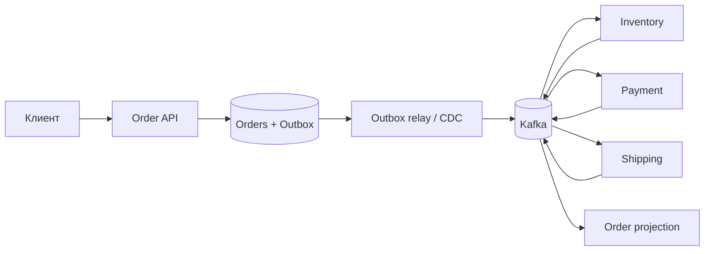

---
---

# Практикум: event-driven обработка заказов

## Содержание

1. [Актуальность материала](#актуальность-материала)
2. [Контекст и требования](#контекст-и-требования)
3. [Commit point и модель отказов](#commit-point-и-модель-отказов)
4. [Нагрузка и ограничения](#нагрузка-и-ограничения)
   - [Проверка достижимости SLO](#проверка-достижимости-slo)
5. [API и событийные контракты](#api-и-событийные-контракты)
6. [Модель данных и компоненты](#модель-данных-и-компоненты)
7. [Этап 1 — транзакционное ядро](#этап-1--транзакционное-ядро)
8. [Этап 2 — надёжная доставка](#этап-2--надёжная-доставка)
9. [Этап 3 — saga и масштабирование](#этап-3--saga-и-масштабирование)
10. [Этап 4 — эксплуатация и DR](#этап-4--эксплуатация-и-dr)
11. [Итоговая защита](#итоговая-защита)
12. [Приёмочные сценарии](#приёмочные-сценарии)

## Актуальность материала

- **Проверено:** 15 октября 2026 года — commit point, workload/backlog, транзакционная дедупликация и сценарии приёмки; остальной обзор ревизии 4 августа 2026 года.
- **Цель:** Java 21+, PostgreSQL 18 и Kafka 4.0 для рассматриваемых гарантий; примеры `current`, контракты учебные, готового приложения нет.
- **Первичные источники:** [Kafka 4.0: delivery semantics](https://kafka.apache.org/40/design/design/#message-delivery-semantics), [PostgreSQL 18: изоляция](https://www.postgresql.org/docs/18/transaction-iso.html), [синхронная/асинхронная репликация](https://www.postgresql.org/docs/18/warm-standby.html), [INSERT / ON CONFLICT](https://www.postgresql.org/docs/18/sql-insert.html), [CloudEvents 1.0.2](https://github.com/cloudevents/spec/blob/v1.0.2/cloudevents/spec.md).
- Перед реализацией сверьте настройки клиента с выбранной версией Kafka; «exactly once» не заменяет end-to-end идемпотентность внешних эффектов.

## Контекст и требования

Marketplace принимает заказ, резервирует товар, авторизует оплату и запускает доставку.

**Функциональные требования:** создать/отменить заказ; наблюдать статус; резервировать позиции; инициировать платёж; компенсировать частичный успех; публиковать факты для аналитики и уведомлений.

**Нефункциональные требования:** API availability 99,95%; p95 принятия ≤ 250 мс без ожидания fulfillment; 99% принятых заказов приходят в терминальный статус за 2 минуты в согласованном штатном workload. Заказ после `202` считается принятым, но ещё не оплаченным/завершённым. Сохранность зависит от класса отказа, как определено ниже; RTO≤1 час. События содержат минимум PII.

## Commit point и модель отказов

`202` возвращается после commit одной DB-транзакции с заказом, idempotency result и outbox. Факт публикации в Kafka не является условием ответа; relay обязан позже доставить outbox и допускает повторы. `CONFIRMED` — отдельное бизнес-состояние после проверки склада/оплаты; оно не синоним HTTP acceptance.

| Класс отказа | Обещание и условие реализации |
|--------------|--------------------------------|
| Crash приложения или потерянный HTTP-ответ | Заказ после commit сохраняется, повтор с тем же ключом получает исходный order id; до commit эффекта нет |
| Потеря primary/AZ | RPO принятого заказа = 0 только если до `202` обеспечена требуемая синхронная сохранность в другой AZ и failover выбирает подходящую копию с fencing |
| Потеря региона при async DR | Допуск RPO≤1 мин относится и к принятому состоянию заказов/outbox; до минуты уже принятых заказов может отсутствовать. Это бизнес-компромисс, а не «нулевая потеря» |
| Производные projections/аналитика | Допускается восстановление replay; потеря проекции не равна потере authoritative order |
| Внешний платёж уже выполнен, локальный статус утрачен | Сверка по стабильному business key/provider reference до повтора; возврат/ручная reconciliation не равны восстановлению потерянного заказа |

Для упражнения выберите один DR-контракт: **A** — бизнес принимает минутный региональный RPO и процедуру сверки; **B** — никакой принятый заказ не теряется при потере региона, тогда до `202` требуется durable запись вне этого региона либо иной доказанный recovery source. Для B пересмотрите latency/availability и цену. Сначала зафиксируйте выбор в ADR; нельзя одновременно обещать zero loss и опираться только на асинхронную копию с ненулевым RPO.

## Нагрузка и ограничения

Гипотезы: 5 млн заказов/сутки, пик 10× среднего ≈ 580 order commands/s; 6 доменных событий на заказ ≈ 350 events/s в среднем и 3 500/s в пик; 2 КБ/событие ≈ 7 МБ/с пикового payload. Хранение 30 дней без replication ≈ 1,8 ТБ; пересчитайте с replication factor, индексами и 35% headroom.

Ограничения: платёжный провайдер допускает 300 RPS и отвечает неоднозначно при timeout; склад принимает идемпотентный `reservationId`; порядок нужен внутри заказа, а не глобально; PII нельзя помещать в долгоживущий log.

### Проверка достижимости SLO

Для воспроизводимости baseline — 58 orders/s, пик — 580/s, каждый заказ требует одной авторизации; retries отдельно. Из 300 provider RPS зарезервируйте 30/s на проверки статуса и повторы: эффективная ёмкость новых платежей `μ=270/s`. Два профиля пика — 60 и 180 секунд — проверяются независимо; затем вход возвращается к 58/s. Остальные стадии вместе укладываются в измеренный бюджет 5 секунд, либо расчёт пересматривается.

```text
backlog = max(0, λ - μ) × burst_duration
max_payment_wait ≈ backlog / μ
drain_after_burst = backlog / (μ - baseline), только при μ > baseline

60 с:  (580 - 270) × 60  = 18 600;
       wait ≈ 68,9 с; drain ≈ 87,7 с после пика.
180 с: (580 - 270) × 180 = 55 800;
       wait ≈ 206,7 с; drain ≈ 263,2 с после пика.
```

Первый профиль согласуется с двухминутным deadline только при подтверждённых FIFO, времени стадий и распределении retries. Во втором значимая доля заказов ждать будет дольше двух минут; добавление workers не увеличивает квоту. Требуется admission control, отсроченный контракт, увеличение согласованной квоты или пересмотр SLO. `429` до durable acceptance не включается в terminal-time принятых заказов, но нельзя скрыть его из availability/acceptance SLI. Рассчитайте долю нарушений, а не только максимальное ожидание; при outage provider 60 секунд повторите расчёт с нулевой ёмкостью на этом интервале.

## API и событийные контракты

```http
POST /v1/orders
Idempotency-Key: 01J...

{"customerId":"c-7","items":[{"sku":"A-42","quantity":2}]}
```

Ответ `202 Accepted` содержит `orderId`, `status: PENDING`, `statusUrl`. Валидация — `400/422`, повтор иного payload под тем же ключом — `409`, перегрузка — `429/503` с `Retry-After`.

```json
{
  "specversion": "1.0",
  "id": "01J...",
  "type": "commerce.order.created.v1",
  "source": "/order-service",
  "subject": "orders/o-42",
  "time": "2026-08-04T12:00:00Z",
  "datacontenttype": "application/json",
  "data": {"orderId":"o-42","customerRef":"c-7","totalMinor":998000,"currency":"RUB"}
}
```

Зафиксируйте partition key=`orderId`, schema compatibility, semantic versioning, owner и retention. Событие — неизменяемый факт; команды именуйте отдельно. Не обещайте глобальный порядок. Изучите [Kafka Schema Registry](../очереди/кафка/08-schema-registry.html) и [асинхронные системы](../system%20design/05-асинхронность-и-событийные-системы.html).

## Модель данных и компоненты

`orders(id, customer_id, status, total_minor, currency, version, created_at)`, `order_item`, `outbox(id, aggregate_id, type, payload, created_at, published_at)`, `processed_message(consumer, message_id, result, processed_at)`, `saga(order_id, step, state, deadline_at)`. Уникальные ключи защищают business id и deduplication; определите retention и очистку.



## Этап 1 — транзакционное ядро

Сначала сохраните заказ и outbox-запись одной PostgreSQL-транзакцией; `GET` читает authoritative state. Реализуйте state machine с допустимыми переходами, request idempotency и optimistic locking. Напишите unit/property tests переходов, DB integration, API contracts и тесты гонок. Сравните polling publisher и CDC, не внедряя оба автоматически.

**Архитектурное ревью:** где commit point ответа `202`? Может ли заказ существовать без события? Как клиент узнает исход? Какие состояния терминальны?

**Ожидаемые trade-offs:** outbox устраняет опасный dual write ценой relay и cleanup; polling проще CDC, но создаёт lag/load; асинхронный API быстрее, но требует status UX.

## Этап 2 — надёжная доставка

Настройте ключи partition, producer acknowledgements и retry policy; consumer делает DB-effect и запись inbox/dedup в одной транзакции, а offset подтверждает после неё. Обработайте duplicate, poison message, schema mismatch, timeout и rebalance. Введите retry topic/DLQ только с owner, лимитом попыток, redrive-процедурой и алертом. Проверьте crash до/после side effect и replay production-like потока.

**Архитектурное ревью:** что означает at-least-once на каждой границе? Каков idempotency key платежа? Сохраняется ли порядок при retry? Можно ли безопасно replay после исправления бага?

**Ожидаемые trade-offs:** dedup хранит состояние и требует retention; DLQ изолирует poison events, но может скрыть business backlog; строгий порядок ограничивает parallelism; транзакции Kafka не покрывают произвольный внешний API. См. [механизмы Kafka](../очереди/кафка/03-ключевые-механизмы.html).

## Этап 3 — saga и масштабирование

Выберите choreography или orchestrator и обоснуйте. Задайте deadlines и компенсации: release inventory, void/refund payment, cancel shipment; компенсация сама идемпотентна и может требовать ручной reconciliation. Рассчитайте partitions по throughput, consumer processing rate и сроку восстановления backlog: `drain time = backlog / (capacity - arrival rate)`. Добавьте backpressure, quota и bulkhead для платёжного лимита.

**Архитектурное ревью:** где виден общий workflow? Что делать при необратимой отправке? Как избежать циклов событий? Сколько partitions нужно сейчас и через год? Как меняется ordering при repartition?

**Ожидаемые trade-offs:** orchestration облегчает наблюдение, но концентрирует coordination; choreography снижает coupling, но размывает процесс; больше partitions даёт throughput ценой порядка, rebalance и стоимости.

## Этап 4 — эксплуатация и DR

Определите SLI: accept latency/error rate, consumer lag в секундах, oldest-message age, terminal-time, duplicate/compensation/DLQ rate. Протяните correlation/trace context без высокой cardinality. Примените mTLS/ACL, отдельные service accounts, encryption, schema authorization и secret rotation. Для эволюции событий выберите backward-compatible схему либо upcaster и canary consumers; для переноса read model — backfill/dual-read и контролируемый cutover. Независимый dual-write без reconciliation не обеспечивает безопасную миграцию.

Для DR задокументируйте восстановление DB, topic/config/schema registry, offsets либо полный replay, failover DNS и reconciliation платежей. Репетируйте broker loss, AZ loss, corrupted deployment и region loss; сравните backup/restore, warm standby и active-active. Используйте [Kafka production](../очереди/кафка/10-эксплуатация-production.html), [observability](../system%20design/08-наблюдаемость-безопасность-и-эксплуатация.html), [Kubernetes](../kubernetes/README.html) и [AWS](../aws/README.html).

**Архитектурное ревью:** какие метрики являются пользовательскими? Совместимы ли rolling versions? Как проверить RPO/RTO? Как исключается повторный charge после failover?

**Ожидаемые trade-offs:** multi-region replication сокращает RPO, но усложняет ownership и порядок; replay восстанавливает projections, но требует детерминизма; расширенная трассировка улучшает расследования ценой sampling/storage.

## Итоговая защита

Защитите контракты, consistency model, error taxonomy, идемпотентность end-to-end, миграции, security, observability, тестовую стратегию, capacity на 12 месяцев и DR runbook. Представьте альтернативу без Kafka или без saga и критерии, при которых она выгоднее.

## Приёмочные сценарии

Используйте синтетические SKU и payment stub с журналом операций, квотой 300/s и возможностью выполнить авторизацию, затем потерять ответ. Все ретраи передают один стабильный ключ платежа. Базовый результат — первые три сценария, production/advanced — остальные.

| Входы и инъекция отказа | Ожидаемый результат | Доказательство |
|------------------------|--------------------|----------------|
| Два `POST` с одним ключом и hash; crash перед commit и отдельно после commit до ответа | До commit нет заказа/outbox; после commit один order id и одна исходная outbox-запись, повтор возвращает тот же результат | API-ответы, DB-снимки и trace commit point |
| Consumer падает после commit DB-effect+inbox, но до commit offset; повторяем доставку | Ровно один бизнес-эффект, одна inbox-запись; повтор не выполняет DB-effect и позволяет продвинуть offset | Перезапуск процесса, offset до/после и SQL-count эффектов |
| Payment stub выполнил авторизацию и вернул timeout; сообщение доставляется дважды | Одна авторизация в журнале провайдера; заказ разрешает неизвестный исход через тот же ключ/status, без нового charge | Лог stub с ключами и журнал переходов saga |
| Пики 580/s на 60 и 180 с, затем 58/s; quota stub 300/s | Квота не превышена; измерены terminal-time и backlog. Для длинного пика показано нарушение или обоснованное ограничение приёма; никакой скрытой потери команд | График arrival/service/backlog, accepted/rejected, доля deadline misses и drain time |
| `PaymentAuthorized` после deadline/отмены, повтор компенсации и повтор старого события | Только разрешённые переходы; одна бизнес-компенсация; запоздалое событие не возвращает заказ в оплаченный статус молча | Таблица переходов и журнал провайдера/склада |
| Failover с утратой части DB/offsets по выбранному DR A/B | Измеренные RPO/RTO соответствуют ADR; сверка платежей не порождает повторных списаний; проекция пересобирается | Таймлайн, множество accepted order ids до/после, provider reconciliation и контрольные суммы projection |

Для state machine и поздних событий объясните действие, если компенсация невозможна автоматически. Одного `exactly_once=true` в конфигурации недостаточно для выполнения этой таблицы; см. [атомарную идемпотентность](../system%20design/13-consensus-и-распределенная-координация.html#идемпотентность-дедупликация-и-replay).

<script type="module" src="../assets/mermaid-init.js"></script>
