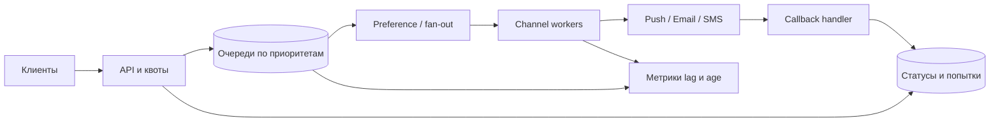

---
---

# Практикум: высоконагруженный сервис уведомлений

## Содержание

1. [Актуальность материала](#актуальность-материала)
2. [Контекст и требования](#контекст-и-требования)
3. [Нагрузка и ограничения](#нагрузка-и-ограничения)
   - [Профили нагрузки и выполнимость](#профили-нагрузки-и-выполнимость)
4. [Контракты и модель данных](#контракты-и-модель-данных)
5. [Схема компонентов](#схема-компонентов)
6. [Этап 1 — минимальный надёжный путь](#этап-1--минимальный-надёжный-путь)
7. [Этап 2 — очереди и защита зависимостей](#этап-2--очереди-и-защита-зависимостей)
8. [Этап 3 — персонализация и масштабирование](#этап-3--персонализация-и-масштабирование)
9. [Этап 4 — multi-region и DR](#этап-4--multi-region-и-dr)
10. [Итоговая защита](#итоговая-защита)
11. [Приёмочные сценарии](#приёмочные-сценарии)

## Актуальность материала

- **Проверено:** 15 октября 2026 года — расчёты workload/backlog и сценарии приёмки; стековые и провайдерские рекомендации ревизии 4 августа 2026 года.
- **Цель:** стабильные distributed-systems концепции; реализация Java 21+, очередь/оркестратор выбираются в ADR. Статус примеров — `current`; квоты ниже — синтетические входы для теста, не реальные лимиты поставщика.
- **Первичные источники проверенных принципов:** [Google SRE: определение SLO](https://sre.google/sre-book/service-level-objectives/), [Kafka 4.0: delivery semantics](https://kafka.apache.org/40/design/design/#message-delivery-semantics), [PostgreSQL 18: атомарная фиксация и конкуренция](https://www.postgresql.org/docs/18/transaction-iso.html). Конкретные версии Kubernetes, OpenTelemetry и managed-очередей сверяйте перед реализацией.
- Квоты провайдеров зависят от региона и аккаунта: перед capacity review запросите реальные лимиты.

## Контекст и требования

Сервис принимает transactional и bulk-уведомления, учитывает предпочтения и quiet hours, рендерит шаблон и доставляет push/email/SMS.

**Функциональные требования:** одиночная и пакетная отправка; расписание; локализация; приоритеты; opt-out; статус доставки; suppression/dedup; отмена ещё не отправленной кампании.

**Нефункциональные требования:** ingest 99,99%; p95 API ≤ 100 мс; 99% transactional доставлены провайдеру за 10 секунд, bulk — за 15 минут; per-tenant fairness; RPO transactional ≤ 1 минута, RTO ≤ 30 минут; privacy deletion и audit. Доставка провайдером вне прямого SLO должна измеряться отдельно.

## Нагрузка и ограничения

Гипотезы: 100 млн logical notifications/сутки (≈1157/s), пик ×20≈23 тыс./с; в среднем 1,3 канала на уведомление **до retries**. Envelope 1 КБ даёт ≈30 МБ/с после channel fan-out; повторные попытки увеличивают это отдельно. Bulk-кампания — 20 млн получателей за 15 минут, то есть ≈22,2 тыс./с только для неё. Десятичные КБ/МБ; payload не включает replication и протокольные расходы.

Провайдерские квоты: push 50 тыс./с, email 8 тыс./с, SMS 1 тыс./с; они являются входными гипотезами. Рассчитайте backlog, число workers (`target rate / measured worker rate`), partitions/shards, storage по retention и headroom 40%. Учтите суточный профиль, retry amplification и региональный отказ.

### Профили нагрузки и выполнимость

Для обычного трафика измерьте отдельно число logical notifications, channel deliveries и attempts. Например, 70% уведомлений идут только в push, 30% — одновременно в push+email: коэффициент каналов 1,3. При пике 23 тыс. logical/s получаем push 23 тыс./с и email 6,9 тыс./с до retries. Если на email 10% дополнительных попыток, нужно 7,59 тыс./с — почти вся квота 8 тыс./с, запаса 40% нет. Это сигнал пересмотреть профиль/резерв, а не результат удачного capacity plan.

Чтобы расчёт кампании был однозначным, сначала используйте **один канал на получателя**, без SMS и без retries. Бюджет transactional резервируем заранее: push 5 тыс./с, email 1 тыс./с; bulk получает остаток. Campaign throughput — скорость фактических send attempts к provider, не скорость постановки задания в очередь.

| Профиль кампании 20 млн за 900 с | Требуемый send rate | Вывод при заданных квотах |
|--------------------------------|--------------------|---------------------------|
| A: 80% push, 20% email | Push≈17 778/s, email≈4444/s | Вместе с резервом 5k/1k: ≈22 778/5444/s; укладывается даже при требовании capacity≥1,4× demand |
| B: 100% email | ≈22 222/s при доступных bulk 7000/s | Минимальное время≈2857 с (47,6 мин); за 15 мин остаётся 13,7 млн неотправленных, без retries |
| C: 100% SMS | ≈22 222/s при полной квоте 1000/s | Минимум 20 000 с (5,56 ч), ещё до резерва transactional |

Для A проверьте резерв с реальными retries, rendering и worker capacity. Для B/C нужно отклонить deadline до acceptance, согласовать увеличение квоты или растянуть отправку. Число consumers не отменяет provider cap. На 30-минутном outage backlog растёт как `arrival_rate × 1800`, а после восстановления `drain = backlog / (effective_capacity - arrival_rate)` при положительном знаменателе; transactional и bulk считайте по каждому каналу отдельно.

**Тестовый workload:** baseline logical 1157/s, 70/30 mix выше; обычный пик 23 тыс./с на 60 секунд, после него baseline. Кампанию A запустите отдельным прогоном с обычным baseline и отдельно совместите с пиком: суммарные channel demand и SLO могут стать невыполнимыми. Seed `42`, два tenant с 90/10% входа, фиксированный recipient hot spot 1%; сравните fairness и deadline misses. Зафиксируйте, включает ли burst-коэффициент кампанию, чтобы не посчитать её дважды.

## Контракты и модель данных

```http
POST /v1/notifications
Idempotency-Key: 01J...

{"tenantId":"t-1","recipientId":"u-7","templateId":"receipt-v3","channels":["PUSH","EMAIL"],"priority":"TRANSACTIONAL","parameters":{"order":"o-42"}}
```

Ответ `202` с `notificationId`; `GET /v1/notifications/{id}` возвращает агрегированный статус и причины. Не принимайте произвольный HTML от недоверенного клиента. Для bulk API храните ссылку на immutable audience snapshot, а не миллионы адресатов в request.

Событие `notification.requested.v1` содержит `eventId`, `tenantId`, `notificationId`, `recipientRef`, `templateVersion`, `channels`, `priority`, `scheduledAt`, `correlationId`; PII разрешайте worker через защищённый профиль по короткоживущему доступу. Delivery result включает provider message id и нормализованный error class.

Модель: `notification`, `delivery_attempt`, `idempotency_key`, `template_version`, `preference`, `suppression`, `campaign`, `audience_chunk`. Разделяйте immutable intent и изменяемое состояние; задайте TTL payload/status, legal hold, encryption и partition key. Изучите [Java concurrency](../java/multithreading/README.html), [PostgreSQL partitioning](../базы%20данных/postgresql/09-partitioning-sharding.html) и [Kafka](../очереди/кафка/README.html).

## Схема компонентов



## Этап 1 — минимальный надёжный путь

Реализуйте API, durable intent, outbox и один worker одного канала. Введите idempotency на ingest и provider send, immutable template version, consent check и state machine. Классифицируйте ошибки: permanent (invalid address), transient (timeout/429/5xx), ambiguous (timeout после send). Retry — exponential backoff с jitter, deadline и max attempts; неоднозначный исход сверяется по provider idempotency/status.

Тесты: unit для policy/template, integration с БД/очередью, contract с provider stub, duplicate/concurrency, timeout boundary, golden rendering и end-to-end. См. [Testcontainers](../тестирование/02-testcontainers.html).

**Архитектурное ревью:** когда API вправе вернуть `202`? Какая запись является source of truth? Как не отправить после opt-out? Как различить retryable и permanent?

**Ожидаемые trade-offs:** durable acceptance повышает latency записи, но предотвращает потерю; provider idempotency упрощает ambiguity, но доступна не всегда; поздняя проверка consent точнее, но добавляет dependency.

## Этап 2 — очереди и защита зависимостей

Разделите transactional/bulk очереди, примените weighted fair scheduling, tenant token buckets, channel concurrency limits, circuit breaker и backpressure. Запретите бесконечные retries; DLQ должна иметь owner, TTL и redrive с повторной проверкой consent. Autoscaling связывайте с oldest-message age и drain rate; задайте minimum capacity для transactional.

**Архитектурное ревью:** может ли bulk вытеснить receipt? Где enforced глобальная provider quota? Что произойдёт при 30-минутном outage? Как избежать retry storm?

**Ожидаемые trade-offs:** отдельные очереди обеспечивают isolation ценой ресурсов; batching повышает throughput, но ухудшает tail latency; circuit breaker сохраняет систему, но увеличивает backlog; strict fairness может недоиспользовать capacity.

## Этап 3 — персонализация и масштабирование

Добавьте audience chunking, локализованный rendering, immutable object storage для больших payload, callback ingestion и reconciliation job. Сравните push и pull fan-out, PostgreSQL/Kafka/managed queues, единый worker и channel-specific workers. Выполните capacity test до saturation и найдите bottleneck по CPU, heap/GC, connections, IOPS, bandwidth и provider quota. Прогнозируйте baseline, peak, failover peak и стоимость на уведомление.

В observability включите accept/error rate, queue age по priority/channel, send latency, provider errors, retry amplification, suppression и SLO attainment; используйте exemplars/traces и ограниченную cardinality. Security: OIDC, tenant isolation, least privilege, KMS encryption, signed callbacks, replay protection, secrets rotation, audit и запрет PII в логах.

**Архитектурное ревью:** где проходит tenant boundary? Как меняется шаблон для уже поставленного сообщения? Что важнее при overload: freshness, fairness или completeness? Какие метрики предсказывают нарушение SLO?

**Ожидаемые trade-offs:** pre-render упрощает worker, но делает payload крупнее и данные менее свежими; pull fan-out сглаживает нагрузку, но усложняет campaign progress; managed services снижают ops, но добавляют квоты и lock-in.

## Этап 4 — multi-region и DR

Выполните expand/contract миграцию schema и contract compatibility test с rolling versions. Сравните active-passive и active-active с home region tenant/recipient, глобальным idempotency key и fencing. Опишите replication lag, route failover, дубли при переключении, callback routing и reconciliation. DR drill: потеря workers, queue, DB/AZ, провайдера и региона; измерьте RPO/RTO и время drain backlog после возврата.

Не называйте backup стратегией, пока не выполнен restore. Зафиксируйте control-plane dependencies, IaC, восстановление ключей/секретов, шаблонов и suppression lists. См. [multi-region](../system%20design/10-multi-region-и-geo-distributed-системы.html), [Kubernetes observability](../kubernetes/05-мониторинг-логирование.html), [AWS messaging](../aws/07-sqs.html) и [SNS](../aws/08-sns.html).

**Архитектурное ревью:** как исключить двойную отправку из двух регионов? Можно ли потерять status, но не intent? Что произойдёт с quiet hours при delayed drain? Каков критерий возврата в primary?

**Ожидаемые trade-offs:** active-active уменьшает региональную latency, но требует ownership/fencing и дороже; active-passive проще, но standby деградирует без учений; строгая глобальная дедупликация добавляет latency и точку координации.

## Итоговая защита

Представьте две допустимые архитектуры для разных бюджетов. Защитите error policy, идемпотентность, миграции, observability, security/privacy, тесты, capacity model и DR. Отдельно перечислите assumptions, эксперименты для их проверки и сигналы, при которых архитектуру следует пересмотреть.

## Приёмочные сценарии

Все провайдеры — локальные stubs с синтетическими адресатами; задания реально не отправляются. Первые три сценария обязательны в базовом результате.

| Входы и инъекция отказа | Ожидаемый результат | Доказательство |
|------------------------|--------------------|----------------|
| Два одновременных ingest с одинаковым ключом; worker получает один intent дважды | Один notification id и одна логическая доставка каждого выбранного канала при поддержке provider idempotency | DB/inbox, ответы и журнал send stub со стабильными ключами |
| Stub принял send, затем оборвал ответ; worker перезапущен | Не создаётся новый provider key; status lookup/retry разрешает ambiguity согласно политике | Число физических send effects, ключи и переходы delivery_attempt |
| Recipient отписался после enqueue, но до вызова provider; затем redrive той же задачи | Consent проверяется перед отправкой и redrive; send отсутствует. Для уже начатого send сформулировано отдельное ограничение отмены | Время opt-out, барьер worker и пустой send-журнал |
| Профили кампаний A/B/C и два tenant 90/10%; fixed quotas на всех workers вместе | A подтверждён измерением; B/C отклоняются или получают согласованный deadline. Transactional не вытесняется bulk; квота не превышается при scale-out | Per-channel arrival/service/backlog, latency по priority, accepted/rejected и распределение долей tenant |
| Provider недоступен 30 минут, затем восстановлен; часть задач пересекла deadline/quiet hours | Retries ограничены; отменённые/истёкшие задачи не отправляются; drain и SLO violations соответствуют модели | Число попыток, oldest age, размер DLQ и время восстановления backlog |
| Дубликат callback и callback старой попытки после нового успеха | Агрегированный статус не регрессирует; callback аутентифицирован и дедуплицирован | Журнал попыток и итоговая state machine |
| Два региона пытаются отправить один intent при failover | Ownership/fencing соблюдается; внешняя идемпотентность либо явно описанная политика дублей подтверждена stub; RPO intent/status измерены отдельно | Provider-effect count, fencing epoch, множество intent ids и DR-таймлайн |

Нельзя доказать отсутствие двойной отправки одной локальной inbox-таблицей, если provider эффект и commit inbox не атомарны. Для канала без provider idempotency/status lookup отдельно выберите поведение при ambiguous outcome: риск дубля, риск пропуска или ручная сверка; отражайте эту границу в контракте.

<script type="module" src="../assets/mermaid-init.js"></script>
